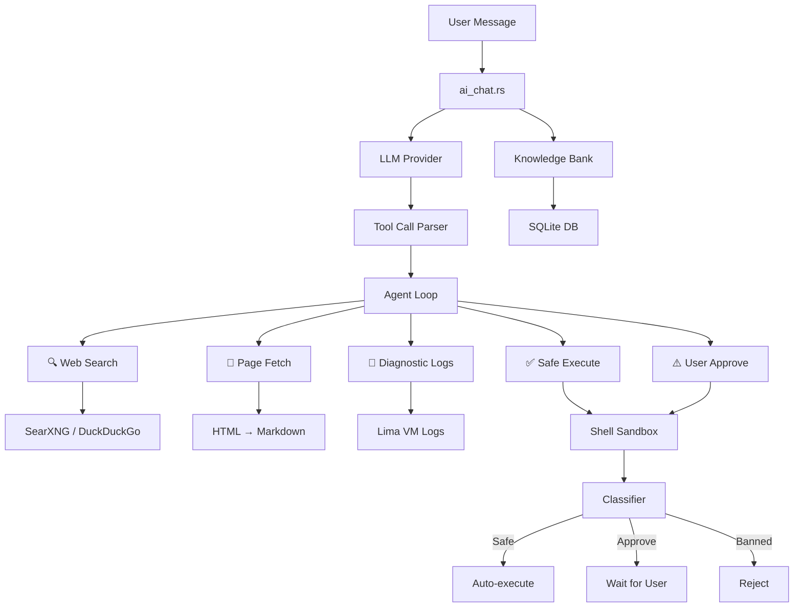

# AI Diagnostic System

ColimaUI includes a self-learning AI diagnostic agent that helps troubleshoot Colima, Lima, Docker, and Kubernetes issues.

## Architecture



### Windows Docker context and actual sender

The packaged brief advertises only syntax recognized by the actual frontend parser; its documentation lookup uses Help/reference reading rather than an unimplemented SEARCH token. SAFE `ai-config-status` returns only a known provider identifier and model/key/endpoint presence. Native read failures return fixed unavailable/unknown text; raw active/inactive keys, model/endpoint text and unrelated settings never enter this tool result. The result flows through the event bus into the next outgoing history; selected provider authentication remains a separate transport argument. Settings storage and NORMAL update authority are unchanged (`src-tauri/resources/windows_docker_assistant.md:7`, `src/lib/aiEvents/config.ts:47`, `src/lib/agentCore.ts:101`, `src/lib/agentCore.ts:348`, `src/lib/agentCore-config.test.ts:40`).

On Windows, native `system::get_app_context` returns the embedded Docker assistant brief instead of loading the macOS/VM skill bundle. The frontend `agentCore.runAgent` appends the currently available event catalog before sending model history. `aiEventBus` filters advertisement/category/dispatch through host capabilities; unavailable or unknown events are refused before an approval request. Legacy QUERY_APP_STATE omits VM/Kubernetes/preset acquisition and DIAGNOSE does not acquire VM logs (`src-tauri/src/commands/system.rs:585`, `src-tauri/resources/windows_docker_assistant.md:1`, `src/lib/agentCore.ts:77`, `src/lib/aiEventBus.ts:28`, `src/lib/agentCore.ts:142`, `src/lib/agentCore.ts:166`, `src/lib/agentCore.ts:214`, `src/lib/agentCore.ts:242`). This changes deterministic capability context, not model/provider calls, reasoning-round limits or autonomy. The backend remains authoritative. Windows omits `build-image`, `compose-build` and `compose-pull` consistently from advertisement, category lookup and direct dispatch because their legacy handlers generate commands the sandbox refuses even after approval. Supported Docker/Compose actions and the macOS/Linux catalog are preserved; this does not expand the sandbox whitelist.

Supported Container/Compose query rejection becomes a fixed redacted unavailable/unknown projection when host policy is Windows or unresolved; successful empty reads remain arrays. Verified macOS/Linux retain their existing projection and legacy acquisition/approval behavior. The actual sender fixture covers all four read outcomes across Windows/unknown/macOS/Linux with substituted model calls; it changes no approval or reasoning/provider budget (`src/lib/agentCore.ts:222`, `src/lib/agentCore.test.ts:54`).

Windows resource references are confined to the packaged resource base. Retrieved references, memories and workload output remain untrusted information; they cannot grant host or target authority (`src-tauri/src/commands/system.rs:574`). The broader VM/host examples below apply only where that host feature is supported.

## Multi-Provider AI Chat (`commands/ai_chat.rs`)

Supports multiple LLM providers through a unified interface:

| Provider | Models | API |
|----------|--------|-----|
| Anthropic | Claude 3.5, Claude 3 | `api.anthropic.com` |
| OpenAI | GPT-4, GPT-3.5 | `api.openai.com` |
| Google | Gemini Pro, Gemini Flash | `generativelanguage.googleapis.com` |
| Ollama | Any local model | `localhost:11434` |
| OpenRouter | Any model | `openrouter.ai` |
| Groq | Llama, Mixtral | `api.groq.com` |
| Together AI | Various | `api.together.xyz` |
| Mistral | Mistral models | `api.mistral.ai` |
| DeepSeek | DeepSeek models | `api.deepseek.com` |

Configuration is stored in the Knowledge Bank SQLite database and managed via the Settings page.

## 5-Tool Agent Loop (`commands/agent_loop.rs`)

The AI agent has access to 5 tools for autonomous troubleshooting:

### 1. Web Search (`commands/searxng.rs`)
- Primary: SearXNG instance (configurable)
- Fallback: DuckDuckGo HTML scraping
- Returns structured search results with titles, URLs, and snippets

### 2. Page Fetch
- Fetches web pages and converts HTML to Markdown
- Uses `scraper` + `html2md` for clean content extraction
- Respects content limits to fit LLM context windows

### 3. Diagnostic Logs (`commands/colima.rs`)
- Collects Lima VM logs: `ha.stderr.log`, `serial.log`
- Detects zombie processes, stale lock/PID/socket files
- Inspects Colima instance YAML configuration

### 4. Safe Command Execution (auto-run)
- Read-only diagnostic commands execute automatically
- Examples: `docker ps`, `colima status`, `cat /var/log/...`, `ps aux`

### 5. User-Approved Execution
- State-changing commands require explicit user approval
- Examples: `colima stop --force`, `pkill qemu`, `rm -f /tmp/...`
- User sees the command and clicks "Approve" or "Reject"

## Command Sandbox (`commands/shell_sandbox.rs`)

Three-tier safety classification:

### Tier 1: Safe (Auto-execute)
Commands that only read state:
```
ps, cat, ls, df, du, free, uptime, whoami, hostname,
docker ps, docker images, docker logs, docker inspect,
colima status, kubectl get, limactl list, ...
```

### Tier 2: Approve (User confirmation required)
Commands that modify state:
```
docker stop, docker rm, colima stop, colima delete,
pkill, kill, rm (specific files), ...
```

### Tier 3: Banned (Rejected at Rust level)
Commands that are always blocked, even if AI requests them:
```
sudo, su, eval, exec, rm -rf /, shutdown, reboot,
mkfs, dd, format, curl | sh, wget | sh, ...
```

Windows text commands retain Safe/NeedsApproval/Banned classification but permit only supported Docker argv through the captured engine and bounded child-process owner. Approval cannot grant unavailable VM/Kubernetes/provisioning/host-shell operations or override connection selectors. `POST /api/cli/execute_stream` reuses the safe executor: it carries no approval grant and emits bounded completed stdout/stderr/exit, or a redacted error; it is not an interactive terminal (`src-tauri/src/commands/shell_sandbox.rs:261`, `src-tauri/src/commands/shell_sandbox.rs:289`, `src-tauri/src/routes/kb.rs:98`).

## Knowledge Bank (`commands/knowledge_bank.rs`)

SQLite-backed memory uses the shared application data root: native LocalAppData/ColimaUI on Windows and the existing `.colima-ui` location on macOS/Linux (`src-tauri/src/path_util.rs:76`).

### Schema

```sql
-- Builtin solutions (22+ pre-loaded)
CREATE TABLE solutions (
    id INTEGER PRIMARY KEY,
    error_pattern TEXT,
    solution TEXT,
    category TEXT,
    upvotes INTEGER DEFAULT 0,
    downvotes INTEGER DEFAULT 0
);

-- User memories (custom knowledge)
CREATE TABLE memories (
    id INTEGER PRIMARY KEY,
    content TEXT,
    category TEXT,
    created_at TEXT,
    updated_at TEXT
);

-- Anti-patterns (solutions marked as bad by user)
CREATE TABLE anti_patterns (
    id INTEGER PRIMARY KEY,
    pattern TEXT,
    reason TEXT
);

-- Settings (AI provider config, preferences)
CREATE TABLE settings (
    key TEXT PRIMARY KEY,
    value TEXT
);

-- Presets (instance configuration presets)
CREATE TABLE presets (
    id INTEGER PRIMARY KEY,
    name TEXT,
    config TEXT
);
```

### Feedback Loop

1. AI proposes a solution
2. User clicks 👍 → Solution saved to `solutions` with upvote
3. User clicks 👎 → Pattern saved to `anti_patterns` so AI avoids it in future
4. On next similar error, AI queries knowledge bank first before web search

### Commands

| Function | Purpose |
|----------|---------|
| `kb_query(error)` | Find matching solutions for an error pattern |
| `kb_learn(error, solution)` | Save a new solution |
| `kb_feedback(id, positive)` | Upvote or downvote a solution |
| `kb_save_anti_pattern(pattern, reason)` | Record what doesn't work |
| `add_memory(content, category)` | Save custom knowledge |
| `search_memory(query)` | Search memories by text |

## Frontend Integration

### AI Chat Panel (`components/AiChatPanel.svelte`)
- Chat interface with message history
- Tool execution visualization (search results, command output)
- Inline approve/reject buttons for sandbox commands
- 👍/👎 feedback buttons on AI responses
- Provider/model selection in settings

### AI Event Bus (`lib/aiEvents/`)
- Domain-specific tool registrations for each area (Docker, K8s, Colima, Lima, etc.)
- Allows AI to invoke UI actions (navigate to page, refresh data, etc.); advertisement, category lookup and execution share host-feature availability (`src/lib/aiEventBus.ts:47`)

### AI Tool Parser (`lib/aiToolParser.ts`)
- Parses XML-style tool calls from LLM responses
- Extracts tool name, parameters, and result expectations

## Automatic repair and evidence limits

Raw daemon events retain the originating availability generation before display debounce. Self-heal clears counting state across recovery, rejects stale generations and validates the original connection/host capability before an automatic attempt. Kill switch, Suggest default, advisory-only actions and per-rule hourly quota outcomes remain at the existing executor; a capability change does not grant autonomy (`src-tauri/src/docker_state.rs:224`, `src-tauri/src/commands/self_heal.rs:607`, `src-tauri/src/commands/self_heal.rs:679`, `src-tauri/src/commands/self_heal.rs:827`).

Deterministic fixtures inspect the actual outgoing frontend sender and event filter with substituted model/effect seams, plus real router policy-refusal assertions. They are source mappings; current run evidence is required for execution, and no live-model evaluation or native/provider result is established (`src/lib/agentCore.test.ts:28`, `src/lib/aiEventBus.test.ts:15`, `src-tauri/src/api_server.rs:520`). Read `docs/integration-test-reference.md` and the canonical Windows cases before claiming coverage.

## External Agent Integration

ColimaUI can be orchestrated by external AI agents via the headless CLI chat endpoint:

```bash
curl -H "Authorization: Bearer <TOKEN>" \
     -X POST http://127.0.0.1:11420/api/cli/chat \
     -d '{"prompt": "Check if any containers are exited and remove them"}'
```

The external agent skill is defined in `external_skill/SKILL.md` with full API documentation.
