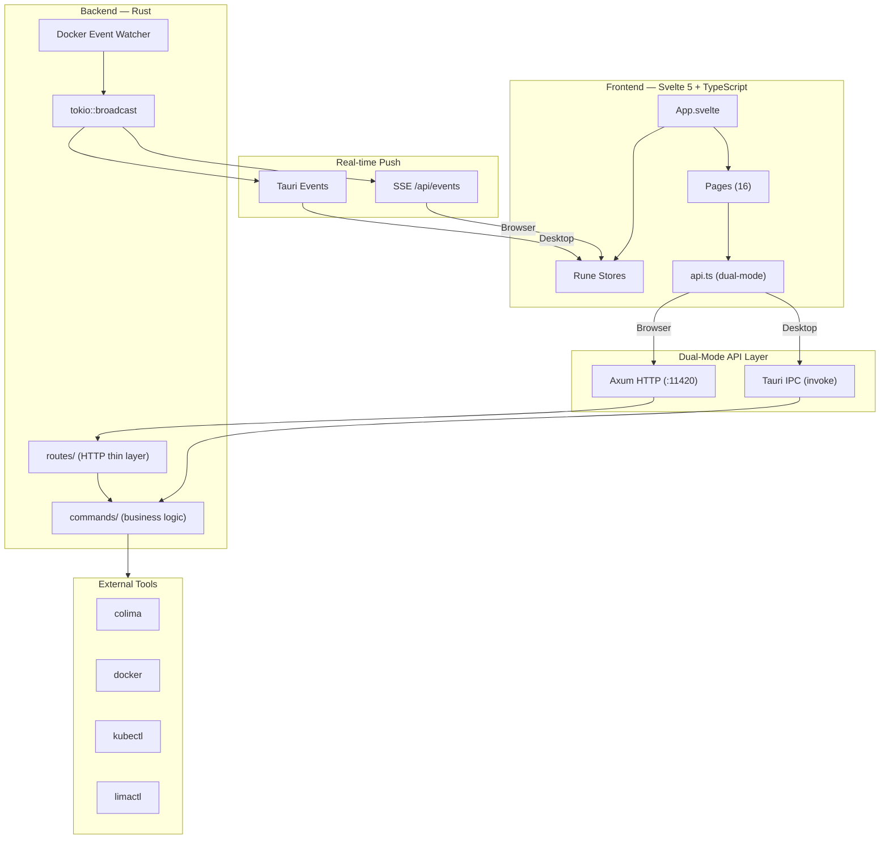

# Architecture

ColimaUI uses a **dual-mode, event-driven architecture** that works as both a native desktop app and a browser-based web application, sharing the same Rust backend.

## High-Level Overview



## Dual-Mode Design

The frontend detects whether it's running inside Tauri (native) or a browser:

```typescript
// src/lib/env.ts — the single detection helper; never re-implement it inline.
export function isRunningInTauri() {
  if (typeof window === 'undefined') return false;
  const w = window as Window & { __TAURI_INTERNALS__?: unknown; isTauri?: unknown; __TAURI_IPC__?: unknown };
  return !!(w.__TAURI_INTERNALS__) ||   // Tauri v2
         !!(w.isTauri) ||
         !!(w.__TAURI_IPC__) ||          // Tauri v1, kept for older webviews
         navigator.userAgent.includes('Tauri') ||
         navigator.userAgent.includes('tauri');
}

// Desktop mode: Tauri IPC (invoke)
// Browser mode: HTTP fetch to localhost:11420
```

Several signals are checked rather than one: `__TAURI_IPC__` is the **v1** global
and is absent in v2, which exposes `__TAURI_INTERNALS__`. A single-global check
silently mis-detects the desktop app as a browser, and the failure is invisible —
the UI merely loses the features it gates behind desktop mode.

This allows **one codebase** to serve both modes without conditional branches in page components.

## Event-Driven Updates

| Mode | Push Mechanism | Fallback |
|------|---------------|----------|
| **Desktop** | Tauri IPC events (`instances-update`, `docker-state-updated`) | — |
| **Browser** | `EventSource` → `/api/events` (SSE) | HTTP polling (5s while visible) |

The backend uses `tokio::broadcast` channels to fan-out events to both Tauri events and SSE simultaneously.

## Request Flow

### Desktop Mode
```
User Action → Svelte Component → api.ts → tauri.invoke() → lib.rs → commands/*.rs → CLI tool → Response
```

### Browser Mode
```
User Action → Svelte Component → api.ts → fetch() → api_server.rs → routes/*.rs → commands/*.rs → CLI tool → Response
```

## Security Architecture

Security validations are applied at the **commands layer** so both entry points (Tauri IPC and HTTP) are protected:

```
┌─────────────────┐     ┌─────────────────┐
│  Tauri IPC       │     │  HTTP Routes     │
│  (invoke)        │     │  (Axum)          │
└────────┬────────┘     └────────┬────────┘
         │                       │
         └──────────┬────────────┘
                    │
         ┌──────────▼──────────┐
         │  commands/*.rs       │
         │  - shell injection   │
         │  - banned flags      │
         │  - container ID      │
         │  - host mount block  │
         └──────────┬──────────┘
                    │
         ┌──────────▼──────────┐
         │  CLI Tools           │
         │  docker / colima /   │
         │  kubectl / limactl   │
         └─────────────────────┘
```

### Validation Rules (validation.rs)

| Check | Function | Protects |
|-------|----------|----------|
| Shell injection | `contains_shell_injection()` | `container_exec`, `lima_shell` |
| Container ID format | `is_valid_container_id()` | Container operations |
| Stable terminal target | `is_stable_container_id()` | Interactive Docker terminal target: 12–64 hexadecimal characters, then resource-state/origin revalidation (`src-tauri/src/validation.rs:24`) |
| Banned Docker flags | `BANNED_DOCKER_FLAGS` | `run_container` (blocks `--privileged`, `--pid=host`, etc.) |
| Host root bind mount | Inline check | `run_container` (blocks `source=/` bind mounts) |
| K8s name format | `is_valid_k8s_name()` | Kubernetes resource names |
| Profile name | `is_valid_profile_name()` / `ensure_valid_profile()` | Colima profile arguments — a name starting with `-` would otherwise be read by `colima` as a flag, and the name is also a path component under `~/.colima` |
| Resource name | `is_valid_resource_name()` | Lima VM, volume and network names passed positionally to CLI tools |
| Path containment | `assert_path_within()` | Any filesystem path built from user input; fails closed when the parent cannot be resolved |

### Running CLI Commands

Two paths, sharing their environment setup and "not installed" message via
`helpers::build_cmd` and `helpers::describe_exec_error`:

| Path | Use for | Notes |
|------|---------|-------|
| `helpers::run_cmd` | Short commands | Bounded concurrent stdout/stderr capture with a deadline through `child_process::capture` (`src-tauri/src/helpers.rs:170`, `src-tauri/src/child_process.rs:159`) |
| `streaming_cmd::run_cmd_streaming` | Long or large output | stdout goes straight to a file or is consumed line by line, so resident memory does not track payload size |

`streaming_cmd` keeps a registry of in-flight commands so they can be cancelled by
id and killed wholesale at `ExitRequested`. Children are spawned into their own
process group on Unix and cancelled with a group signal — signalling only the direct child
leaves forked helpers alive, still holding the stderr pipe open.

Path confinement is the caller's responsibility; the per-operation base directory
policy is documented on `validation::assert_path_within`.

### Windows engine origin

A resolved `engine_connection` captures one context, local pipe, executable and configuration directory for the process. Its command builder controls ambient Docker selectors/TLS/API variables; saving a next-launch preference does not retarget that connection. CLI and SDK checks require the original Linux daemon identity, order overlapping checks and fence reads across availability generations (`src-tauri/src/engine_connection.rs:20`, `src-tauri/src/engine_connection.rs:55`, `src-tauri/src/engine_connection.rs:136`, `src-tauri/src/engine_connection.rs:354`, `src-tauri/src/engine_connection.rs:449`, `src-tauri/src/engine_connection.rs:465`).

`DockerState` owns the single daemon event stream; SSE consumes its raw events. Both projections use shared snapshot reads that return errors for unavailable/partial responses. Short commands use generic child ownership: Unix process groups, or a Windows suspended child assigned to a kill-on-close Job before resuming (`src-tauri/src/docker_state.rs:108`, `src-tauri/src/docker_state.rs:466`, `src-tauri/src/sse.rs:151`, `src-tauri/src/child_process.rs:86`, `src-tauri/src/child_process.rs:387`).

Interactive Docker terminals use the existing `SessionKind::ContainerExec` and native IPC lifecycle. Target preflight checks a stable container ID, original engine and running/nonpaused state; creation revalidates it. Windows uses `windows_pty` ConPTY with Job membership at process creation, bounded I/O pumps and draining through Close. Session caps, UTF-8 output trimming, origin-loss input fences and late-acquisition cleanup remain at the existing session/transport owners (`src-tauri/src/commands/terminal.rs:22`, `src-tauri/src/terminal_session.rs:285`, `src-tauri/src/terminal_session.rs:643`, `src-tauri/src/windows_pty.rs:156`, `src/pages/TerminalInstance.svelte:130`). There is no HTTP terminal route or host-shell fallback.

Windows host policy is enforced by `host_features` at command/adapter/tool boundaries and authenticated raw HTTP dispatch; VM/Kubernetes/runtime-install features remain unavailable even if their executables are installed. Capability metadata distinguishes unsupported, missing CLI, stopped engine and ready state. Connection UI separates the immutable active engine, checked candidate and saved next launch; restart admits shutdown under the transfer lock and settles owned work before requesting restart (`src-tauri/src/host_features.rs:5`, `src-tauri/src/host_features.rs:74`, `src-tauri/src/commands/system_capabilities.rs:173`, `src-tauri/src/commands/engine_connection.rs:72`, `src/lib/engineConnection.svelte.ts:77`). Assistance uses captured Docker execution and existing approval/banned policy; safe command SSE emits bounded completed output. Read `docs/ai.md` for sender/tool/self-heal ownership and `docs/specs/windows-docker-ui.md` for qualification. Authored guards and compiler checks do not establish native Windows support.

### Metrics Collection

`commands/metrics_collector.rs` is the app's only sampling loop. Components read
its output rather than polling Docker themselves, so daemon load does not scale
with the number of open views and every figure on screen comes from one reading.

It has two outputs, and the distinction matters:

| Channel | Mechanism | Guarantee |
|---------|-----------|-----------|
| Display | `publish_sse_event("metrics.sample", …)` | Lossy. A slow client gets `stream-lagged` and draws a gap |
| Durable | `set_metric_writer(…)` | Every batch, delivered directly |

Anything that must not lose samples registers a writer. Reading the SSE stream for
that purpose loses data silently under load.

## Background transfers

Copying files in and out of containers and moving images as TAR archives are the
only operations with a lifecycle: they run for minutes, report progress, and can be
cancelled. Three pieces, deliberately separate:

| Piece | Owns |
|-------|------|
| `streaming_cmd` | The child process. Streams stdout to disk, kills process groups, cleans up |
| `transfer_registry` | What transfers *exist* — status, bytes, and a readable outcome |
| `commands::file_transfer` | Validation, argument construction, and the event payloads |

`streaming_cmd`'s map owns in-flight children through output cleanup and publication;
its registration guard releases the entry when that work settles. That cannot answer "what is going on"
after a webview reload, which is why the registry exists alongside it rather than
inside it. The registry registers a job **before** the process spawns — a spawn
failure emits a terminal event microseconds later, for an id the caller does not
have yet — and keeps terminal entries for about a minute so a client that missed
the event can still read the outcome via `GET /api/transfers`.

Output is written to an exclusively created `<name>.<job-id>.part` sibling and published only after complete successful output. `ToFile` permits replacement; `ToNewFile` refuses a destination that appears before publication. The caller retains overwrite permission (`src-tauri/src/streaming_cmd.rs:441`).

File-output transfers and SBOM acquire the same process-local destination claim before child/scanner acquisition. A per-job gate orders accepted cancellation, publication and the first terminal outcome; filesystem I/O runs without holding the registry map lock. UI/HTTP cancellation arriving during publication is refused as finishing, rather than reported accepted. Successful publication settles Success before a later cancellation can change it. Exclusive scratch and caller-owned replace/no-replace permission preserve an existing destination when cancellation wins (`src-tauri/src/transfer_registry.rs:128`, `src-tauri/src/transfer_registry.rs:259`, `src-tauri/src/transfer_registry.rs:445`, `src-tauri/src/transfer_registry.rs:223`, `src-tauri/src/streaming_cmd.rs:441`, `src-tauri/src/commands/file_transfer.rs:40`, `src-tauri/src/commands/security_scan.rs:615`).

Quit closes terminal acquisition, cancels queued/running transfers, stops late stream/child acquisition and waits for registry, child and output cleanup. If settlement exceeds 10 seconds, the app prevents exit and emits `shutdown-blocked`; the data poller presents a localized recovery error, and the private API reference closes only after cleanup succeeds. Explicit engine restart performs cleanup before requesting the restart code; active transfers first require completion or explicit cancellation (`src-tauri/src/lib.rs:404`, `src-tauri/src/commands/engine_connection.rs:82`, `src-tauri/src/transfer_registry.rs:184`, `src/lib/dataPoller.ts:257`). Native lifecycle proof remains pending.

Failure text is redacted **at the source**, before it is emitted: it leaves the
process on two transports and there is no single downstream place that covers both.
Note the limit — `redact` masks home-directory account segments and known secret
shapes, not arbitrary absolute paths, which is why the OS notification layer sends
only a transfer's name and never this field.

Sampling is gated on `sse::subscriber_count("metrics.sample")`, so the collector
stays idle without an Activity subscription; daemon event/liveness work remains independent. `MetricSample` carries an
`instance` column from the outset: samples written before multi-engine support
existed would otherwise be an unattributable mix.

Samples come from the **engine API** (bollard), not the `docker` CLI, and the CPU
delta is computed against the previous tick. CPU history keys include the origin and,
on Windows, its recovery generation; the displayed instance label stays unchanged
(`src-tauri/src/commands/metrics_collector.rs:372`, `src-tauri/src/commands/metrics_collector.rs:420`). Measured with 20 containers at a 2 s
period: **0.14% CPU, 2.8 ms per sample**, down from 11.16% and 669 ms via the CLI —
which also could not sustain a 2 s period at all, because one
`docker stats --no-stream` takes about six seconds with 25 containers. The CLI path
remains as a fallback for engines that do not speak the Docker API (`nerdctl` on
containerd).

Engine-wide figures are deliberately absent from the sample stream:
`engine_resources` derives aggregate CPU by running `docker stats`, the most
expensive call this app makes, for a number the collector already holds as a sum.
The Activity page fetches `/api/system/engine-resources` once when it opens.

The collector imports nothing from `pro`/`subscription` — a unit test asserts it —
so the paid build's involvement is one `set_metric_writer` call at startup.

### Secret Redaction

`src-tauri/src/redact.rs` and `src/lib/redact.ts` strip credentials from any
string that reaches the user, a log, or an LLM prompt. Both sides exist because
the frontend calls LLM providers directly, so provider errors are built in the
browser and never pass through Rust.

Redaction works two ways: by **position** (credential-shaped query parameters
and auth headers, whatever the value looks like — this covers providers we have
never heard of) and by **shape** (known key formats anywhere in the string).
Docker image digests are deliberately excluded from the shape rules so
diagnostics stay readable.

On the frontend the choke point is `globalToast()`: it is the last place every
user-visible message passes through, and it also forwards error text to the AI
diagnostics listener — i.e. off to a third-party LLM.

## HTTP Authentication

The HTTP API uses **Bearer token** authentication:

1. Token is auto-generated at startup with a CSPRNG (`auth::get_api_token`)
2. The desktop webview obtains it over IPC (`auth::api_token`). Browser clients receive it out-of-band in a URL fragment (`#token=…`), which the frontend consumes once and strips from the address bar
3. All endpoints require `Authorization: Bearer <token>`, compared in constant time
4. `/api/health` is the only unauthenticated route; the list is explicit in `api_server.rs`, not pattern-matched
5. SSE endpoints authenticate via `?token=` because `EventSource` cannot set headers. The set of such endpoints is an explicit allowlist (`auth::QUERY_TOKEN_PATHS`) — a route is never switched to query-token auth just because its path ends in `/stream`

**No endpoint hands the token out.** `GET /api/auth/token` used to, from the
public router, claiming CORS as its protection — which restricts browsers and
nothing else. Any local process could read the token and then use the entire
API, including `GET /api/settings` and its configured AI key.

The consequence is intended: a browser tab opened by hand has no credential and
no way to obtain one.

**Browser mode is a development surface.** Neither router mounts a `ServeDir`,
so no build serves the frontend over HTTP — the only page that can reach the API
is the vite dev server on 1420, which is why that origin is in the CORS list. So
the handoff is sized to match: a debug build prints the ready-made
`http://localhost:1420/#token=…` URL to stdout when the server binds, and there
is no in-app "open in browser" affordance because there is nothing to open. If a
packaged build ever serves its own frontend, `auth::api_token` is the seam where
a real handoff belongs.

Native SSE/HTTP consumers resolve this app’s actual bound port through `api_port` IPC and fail while it is unbound; they do not select another healthy local server. Browser development retains the existing health-port discovery. Port discovery does not change Bearer/query-token rules or the private CLI reference (`src-tauri/src/api_server.rs:34`, `src-tauri/src/api_server.rs:416`, `src/lib/api/client.ts:45`).

### Local data and CLI access

`path_util::try_app_data_dir` is the shared app/CLI location owner. Windows resolves the current account’s native LocalAppData Known Folder and appends `ColimaUI`; macOS/Linux retain nonempty `HOME` or `/tmp`, followed by `.colima-ui`. Startup resolves and creates this directory before opening storage. Resolution failure on Windows does not select the launch directory or a public temporary fallback (`src-tauri/src/path_util.rs:76`, `src-tauri/src/windows_host.rs:15`, `src-tauri/src/windows_host.rs:38`, `src-tauri/src/lib.rs:125`).

The external `cui` CLI reads an instance marker from existing `app_settings` through a read-only connection, then reads that instance’s private `api/<instance>.json` for the port and credential. A new instance supersedes the marker before binding; it publishes its own reference only after a successful bind. Missing, invalid or unavailable selected references never trigger a public-health fallback. Closing an older instance removes only its own record (`src-tauri/src/api_reference.rs:72`, `src-tauri/src/api_reference.rs:93`, `src-tauri/src/api_reference.rs:108`, `src-tauri/src/api_reference.rs:125`, `src-tauri/src/api_server.rs:417`, `src-tauri/src/bin/cui.rs:97`).

`private_file` establishes owner-only access before writing and verifies the opened handle before reading. Unix uses mode `0600` and no-follow opens; Windows uses a protected current-account DACL and rejects reparse points, extra hard links or incompatible permissions. Private-file publication failure leaves existing in-app access available. Credentials stay out of settings, errors and evidence; native Windows account-denial and lifecycle qualification remain pending (`src-tauri/src/private_file.rs:8`, `src-tauri/src/private_file.rs:48`, `src-tauri/src/private_file.rs:159`, `src-tauri/src/private_file.rs:225`, `src-tauri/src/api_server.rs:417`).

### Accepted risks

One weakness is known and deliberately left in place, because every available
fix costs a feature the product needs. Revisit it if the threat model changes
(e.g. multi-user machines become a target).

| Risk | Why it stays |
|---|---|
| `capabilities/default.json` allows `https://*` | This is what lets the app reach OpenRouter, Groq, Together, Mistral, DeepSeek and user-configured endpoints (custom Ollama, private SearXNG). Tauri capabilities are compile-time, so a narrow list cannot be extended at runtime — narrowing would permanently break 6 of the 9 advertised providers. The fix is to route provider calls through Rust (`reqwest` is not bound by capabilities) |

## State Management

### Frontend (Svelte 5 Runes)

| Store | File | Contents |
|-------|------|----------|
| Global | `store.svelte.ts` | Instances, containers, images, volumes, networks, compose, system info |
| AI | `store/ai.svelte.ts` | Chat messages, provider config, agent state |
| K8s | `store/k8s.svelte.ts` | Namespaces, pods, deployments, services, CRDs |
| Confirm | `store/confirm.svelte.ts` | Confirmation dialog state |

On supported macOS/Linux hosts, failed Docker reads do not gate VM-management views or their explicit Start controls. Native POSIX and browser refreshes publish successful C/I, volume and network groups independently, retain prior failed groups and use the same bounded retry/lifetime owner; delayed volume/network reads also publish independently. For already-mounted volume/network views, the loss path keeps cleared lists loading through failed delayed reads, including when capability status still says running. These source policies preserve established recovery paths; native behavior still requires qualification (`src/App.svelte:220`, `src/lib/dataPoller.ts:89`).

Ordinary Windows resource views require host policy, captured-engine readiness, matching C/I `originGeneration` and a complete current four-family read recorded separately in `resourceState.loadedGeneration`. Loss clears resource state and full-read completeness; a newer generation needs its own complete result. Partial C/I provenance remains useful independently to Terminal, while ordinary recovery waits for fresh membership before consuming neutral choices. The shared refresh owner fences fulfillment and rejection by run/revision/current generation; Containers, Images, Networks, Volumes and the retained Terminal picker use it on Windows. Event-side delayed volume/network reads also check the captured event generation before acquisition and publication; native listener disposal retains its own lifetime; Terminal keeps its separate mounted lifetime for ended sessions (`src/lib/dataPoller.ts:31`, `src/lib/dataPoller.ts:89`, `src/lib/dataPoller.ts:167`, `src/pages/Terminal.svelte:66`, `src/App.svelte:230`).

Ordinary Windows resource pages unmount while unavailable. App holds one memory-only recovery scope for the active page and original context/endpoint/engine; generation changes are revisions. Registered snapshots retain unsent fields and neutral checked IDs, filters, detail/tab choices and nested preferences once. They resolve identities against fresh resources, graph, samples or project lists; navigation/origin change/App disposal discards them. Old objects, results, approval/callback/busy state and effect replay are excluded (`src/App.svelte:86`, `src/lib/recoveryDrafts.svelte.ts:17`, `src/pages/Containers.svelte:504`, `src/pages/Activity.svelte:55`, `src/pages/Security.svelte:67`).

### Backend (Rust)

| State | Scope | Purpose |
|-------|-------|---------|
| `DockerState` | `tauri::State` (managed) | Bollard client, container/image cache |
| `PollerState` | `tauri::State` (managed) | Background instance poller handle |
| `ResourceSaverState` | `tauri::State` (managed) | Resource saver mode timer |
| `SYSTEM_INFO_CACHE` | `LazyLock<Mutex<TimedCache>>` | Cached system info (colima/docker versions) |
| `SSE_TX` | `LazyLock<broadcast::Sender>` | SSE event broadcaster |
| `API_TOKEN` | `LazyLock<String>` | Random auth token |
| `PORT_FORWARDS` | `LazyLock<Mutex<HashMap>>` | Active K8s port forwards |
