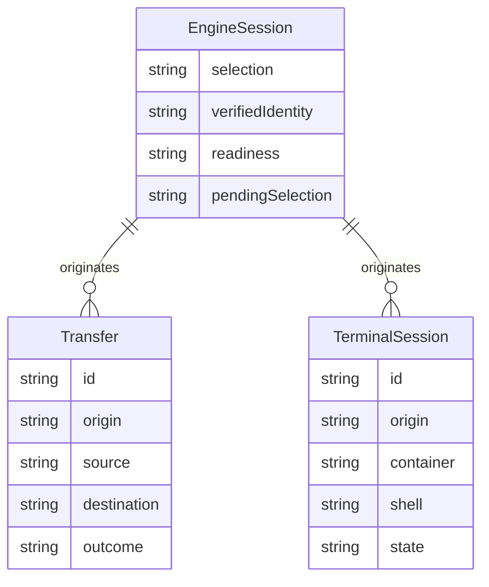

# Existing-engine desktop workflows

> **DRAFT — accepted product scope; implementation and native qualification remain unverified. Test evidence is provisional.**

## Related Documentation

| Type | Link | Purpose |
| --- | --- | --- |
| Delivery and companion design | [Approved plan](../../plans/261014-1121-windows-docker-ui/plan.md) | Source owners, delivery phases, detailed layout and qualification requirements |
| Boundary tests | [Test source](../../src-tauri/tests/) | Executable proof and prerequisites |
| Current architecture | [Architecture](../architecture.md) | Existing transport and lifecycle contracts |

## 1. Overview

A local operator installs the desktop application and uses an existing local container engine to inspect and manage workloads. The operator can manage resources, projects, transfers and interactive container sessions while seeing which engine owns each result. Engine changes require an explicit application restart, and application installation, updates and removal preserve externally owned workloads.

The support boundary is declared in the metadata. Engine provisioning, virtual-machine management, remote connections, additional host platforms, additional container operating systems and new diagnostic autonomy are outside this capability.

## 2. Glossary

| Term | Meaning |
| --- | --- |
| Local operator | Person using the application with permission to operate the selected local engine; the only actor in this capability |
| Engine | Externally managed authority that owns containers, images, volumes and networks |
| Engine session | The engine selection and verified engine identity retained for one application lifetime |
| Pending selection | Validated preference for the next application launch; it does not change the active session |
| Workload | A container or a group of containers belonging to a project |
| Transfer | Cancellable import, export or container-file copy with an observable outcome |
| Terminal session | Interactive input and output attached to a running container on its originating engine |
| Recovery | Checking the original selection and showing readiness or an attributed failure without choosing another engine |

## 3. User Stories & Acceptance Criteria

### US-WINUI-01 — Start and recover

**As a** local operator, **I want to** connect and recover my selected existing engine, **so that** I can distinguish available workloads from an unavailable engine.

**AC-WINUI-01:** Given an existing supported engine, when I launch or recheck, then I see its identity and resources; missing tooling, unsupported selection, unavailable engine and a healthy empty engine have distinct explanations. Recovery retains my selection and input. BR-WINUI-01/02/06.

### US-WINUI-02 — Select the next engine

**As a** local operator, **I want to** save a next-launch selection and restart deliberately, **so that** current actions remain attached to the engine I originally chose.

**AC-WINUI-02:** Given an active session, when I save a different selection, then current resources, jobs and terminals retain their origin and the pending selection is visible. Restart closes terminals only after I finish or explicitly cancel transfers; backing out leaves the current session intact. The next launch revalidates the selection and refuses an unavailable or replaced engine. BR-WINUI-01/02/03.

### US-WINUI-03 — Operate workloads

**As a** local operator, **I want to** inspect and manage resources and projects, **so that** I can perform my normal workload tasks on the chosen engine.

**AC-WINUI-03:** Given a ready engine, when I list, inspect, view logs, create, start, stop, execute within or remove supported resources and projects, then I see the actual resulting state and an attributed failure when the operation cannot complete. No other engine is affected. BR-WINUI-01/02/06.

### US-WINUI-04 — Transfer and interact

**As a** local operator, **I want to** move files and interact with a running container, **so that** I can complete tasks without losing existing files or accidentally entering my host computer.

**AC-WINUI-04:** Given selected files or a running container, when I transfer data or open an interactive session, then completed data matches the requested contents and interactive input reaches the originating container. Cancellation, missing shell, engine loss and close produce honest outcomes; rejected paths and failed transfers preserve prior destinations. BR-WINUI-01/02/03/04/05.

### US-WINUI-05 — Keep control of the application

**As a** local operator, **I want to** use accessible controls, retain approval over diagnostics and manage application installation, **so that** application maintenance never damages my external workloads or grants unintended authority.

**AC-WINUI-05:** Given an installed application, when I navigate, request diagnostics, update, close or uninstall it, then controls remain usable and actions retain existing permissions. Unavailable host actions are refused, unauthorized access cannot operate resources, failed updates preserve the usable installation, and external engines and data remain intact. BR-WINUI-03/05/06.

## 4. Business Rules

### BR-WINUI-01 — Session targeting [HARD]

For ALL supported resource reads, writes, projects, transfers, interactive sessions and diagnostic actions, the active engine session is the sole target. Saving a preference or editing the external engine selection does not retarget it. No operation changes the operator's external global selection. A missing, deleted or unsupported saved selection is refused with an explanation naming that selection; no alternative engine is chosen silently.

**Failure:** "The selected engine is unavailable. Check it or save another selection and restart."
**Evidence:** [Source: rule/windows-ui/BR-WINUI-01] TBD (pre-implementation)

### BR-WINUI-02 — Identity before effects [HARD]

For ALL reconnects and actions from retained resource state, the observed engine identity must match the originating session. A different engine using the same connection address is not the original engine. On loss or mismatch, old resources and metrics become unavailable and retained state cannot authorize a new effect. Recovery verifies the original identity; accepting a replacement requires a new application session.

**Failure:** "The engine identity changed. Restart before operating this engine."
**Evidence:** [Source: rule/windows-ui/BR-WINUI-02] TBD (pre-implementation)

### BR-WINUI-03 — Owned work cleanup [HARD]

For ALL transfers and interactive sessions, each job keeps its origin until it ends. Transfers move from starting to running and then exactly one of success, failed or cancelled; only completed output is success. Terminal sessions move from starting to running and then closed or failed. At most 16 interactive sessions are open; retained output per session is capped at 1 MiB, trimming to a recent 512 KiB window without splitting text. Sessions with no input/output activity for 30 minutes are closed by the next 60-second idle sweep. Repeated close/cancel is harmless; ended work cannot become running again. Restart waits for completed transfers or explicit cancellation and cleanup, closes terminals, and leaves no application-owned child running.

**Failure:** "Finish or cancel active transfers before restarting."
**Evidence:** [Source: rule/windows-ui/BR-WINUI-03] TBD (pre-implementation)

### BR-WINUI-04 — File preservation [HARD]

For ALL supported host paths and file transfers, selected host paths, container paths and engine-side mount paths have distinct meanings. Traversal, escape through an alias, unsupported mount forms and duplicate active writers to one resolved destination are rejected. A file destination changes only after successful completion; cancellation or failure leaves its prior bytes intact. Successful export/import/copy preserves contents across the round trip.

**Failure:** "This path is outside the allowed destination or is already in use."
**Evidence:** [Source: rule/windows-ui/BR-WINUI-04] TBD (pre-implementation)

### BR-WINUI-05 — Authority and trust [HARD]

For ALL entry points, resource operations require the existing local authorization and supported capability. Diagnostic assistance retains safe/approval-required/banned classification. Interactive container access never becomes a host shell or silently installs a shell. Automatic repair retains the kill switch, suggestion default, advisory-only restrictions, quota and originating engine identity. A successful or failed attempted automatic action spends one unit of its rule's trailing one-hour quota; suggested, quota-blocked and switched-off outcomes spend none. Actions recorded exactly one hour before the decision still count; older actions do not. An unreadable quota refuses automatic execution. A persisted private access reference is readable and usable by its owning local account and is unreadable by ordinary non-owning unprivileged local accounts. Privileged administrators and system services are outside that ordinary-account privacy guarantee. A reference is published only after private access is established; if creation or privacy establishment fails, no usable reference is published and external access requiring it fails closed, while existing authorized in-application access and public health retain their contracts. Private credentials and sensitive diagnostics are redacted from user-visible errors and qualification evidence. For ALL stored access credentials, checking assistant configuration reports only whether the relevant configuration is present; it never copies credential values, private endpoint text or unrelated settings into assistance instructions, tool results or conversation content. This includes inactive account credentials. Unreadable configuration is reported as unknown, never as successfully empty. The credential needed for an explicitly selected assistant connection remains usable for authentication.

**Failure:** "This operation is unavailable or requires approval."
**Evidence:** [Source: rule/windows-ui/BR-WINUI-05] TBD (pre-implementation)

### BR-WINUI-06 — External ownership and honest state [HARD]

For ALL application lifecycle actions, the application does not install, start, stop, update or remove an external engine. Application close, upgrade and uninstall preserve external resources. Ordinary uninstall retains application preferences and history; deleting those requires a separate explicit user action. Missing tooling, unreachable engine, empty ready engine, unsupported operation and an actual operation failure remain distinct. User input and selection survive recoverable failures. Existing supported-platform behavior and data locations remain compatible.

**Failure:** "Check the selected engine and try again."
**Evidence:** [Source: rule/windows-ui/BR-WINUI-06] TBD (pre-implementation)

## 5. Domain Model

| Concept | Required facts and meaning | Invariant |
| --- | --- | --- |
| Engine session | Selected name/address; verified engine identity when ready; readiness; pending selection | INV-WINUI-01: active selection is immutable within a session; pending changes become active only after explicit restart and revalidation |
| Transfer | Unique job identity, origin, selected source/destination, progress and outcome | INV-WINUI-02: one terminal outcome; success implies complete data, cancellation/failure preserve the prior destination |
| Terminal session | Unique session identity, origin, container identity, shell, observable running/ended status | INV-WINUI-03: input and output retain the origin; ended sessions release owned children and cannot reopen themselves |



**Evidence:** [Source: component/windows-ui/engine-session] [Source: component/windows-ui/transfer] [Source: component/windows-ui/terminal-session] TBD (pre-implementation)

| Concept | Allowed transition | Observable result | Rejected transition |
| --- | --- | --- | --- |
| Engine session | Unavailable → ready after identity verification | Original selected engine's resources appear | Unverified or replacement identity → ready |
| Engine session | Ready → unavailable after loss or mismatch | Old resources stop being presented as current | Unavailable → effect on retained old resource |
| Engine session | Current → new session after explicit restart/cleanup/revalidation | Saved selection becomes active | Saving preference → live retarget |
| Transfer | Starting → running after work begins | Progress belongs to accepted job | Cancelled-before-start → running |
| Transfer | Starting/running → success/failed/cancelled after corresponding settlement | Exact outcome, prior files intact unless success | Terminal outcome → running or a different terminal outcome |
| Terminal session | Starting → running after container session acquired | Container identity and interactive output visible | Unsupported/missing shell → host session |
| Terminal session | Starting/running → closed/failed after close/exit/loss/error | Session ends and owned work stops | Closed/failed → running without a new operator action |

Occurrences: engine loss makes resource state unavailable; verified recovery restores it; completed/cancelled work produces an outcome the operator can read. Persisted application preferences and historical session metadata are not authority over current external resource state.

## 6. Process Flows & Interaction Surface

### 6.1 Process flows

| Operation | Actor intent → steps → result | Story/rules |
| --- | --- | --- |
| OP-WINUI-01 Connect/recover | Select → check → see resources or attributed next action | US-WINUI-01; BR-WINUI-01/02/06 |
| OP-WINUI-02 Save/restart | Save pending choice → finish/cancel transfers → confirm terminal closure → restart → revalidate | US-WINUI-02; BR-WINUI-01/02/03 |
| OP-WINUI-03 Manage resources | Browse → inspect/action → wait for outcome → read actual state | US-WINUI-03; BR-WINUI-01/02/06 |
| OP-WINUI-04 Transfer/interact | Choose source/destination or running container → start → observe progress/output → finish or cancel/close | US-WINUI-04; BR-WINUI-03/04/05 |
| OP-WINUI-05 Maintain/control | Navigate/request help/update/close/uninstall → retain permissions and external data | US-WINUI-05; BR-WINUI-05/06 |

### 6.2 View inventory

| View role | Container role | Now | Later | Not here | Primary action / story |
| --- | --- | --- | --- | --- | --- |
| Readiness setup | Stepped flow | Selection, engine identity, readiness explanation, check/continue | Resources after connection | Runtime installation, host administration | Check and continue; US-WINUI-01 |
| Connection preferences | Full view section | Active and pending choices, selection input, check/save, restart consequence | Resource details | Workload editor, engine provisioning | Save and explicitly restart; US-WINUI-02 |
| Resource overview/detail | Full view with focused detail | Selected engine, resource names/status, operation outcome | Logs, project details, transfer targets | Connection administration | Inspect/manage; US-WINUI-03 |
| Transfer choices/outcome | Focused dialog then status panel | Origin, source/destination, overwrite decision, progress/outcome, cancel | Completed archive/file details | Engine switching | Start or cancel; US-WINUI-04 |
| Interactive workspace | Full view | Engine/container origin, active session, shell choice, input/output and close | Other session choices/history | Host shell, runtime installation | Open/type/resize/close; US-WINUI-04 |
| Assistance | Side panel | Requested help, available operations, nonsecret configuration presence and unknown-state explanations | Manual reference lookup or approved actions | Stored credential values, private endpoints and arbitrary settings | Request help/status; US-WINUI-05 |
| Persistent engine status | Inline status | Active engine readiness and next recovery action | Connection preferences | Unrelated machine internals | Recheck/open preferences; US-WINUI-01 |

### 6.3 Navigation map

Readiness setup → resource overview after a successful check. Persistent status → connection preferences on selection/recovery intent. Resource detail → transfer choices or interactive workspace; back navigation retains an active interactive session. Transfer choices close after job acceptance and the status panel retains progress. Connection preferences → explicit restart only after cleanup; cancel returns to the active session. Help and existing neighboring resource views remain accessible according to capability.

### 6.4 Key observable states

Changed controls support keyboard access, meaningful assistive names/statuses, focus visibility/return, the existing minimum 900 by 600 window and 100%/200% zoom. English, Vietnamese, Chinese and Japanese labels remain available. The eight shared states below apply where named; no view interprets unavailable as empty.

At the separately declared equivalent content size, the operator can read all information and complete the same actions without having to scroll in both directions to follow ordinary content. The desktop minimum window remains unchanged. A region is excepted only when its usage or meaning requires a two-dimensional arrangement, with its specific reason recorded; surrounding headings, labels, forms, navigation, status and actions still meet the content-size requirement. A resource table or interactive output region does not exempt its whole view.

| State | Applicable views | What the operator perceives | Rule |
| --- | --- | --- | --- |
| Checking/loading | Setup, status, preferences, resources | Progress and retained input; no invented result | BR-WINUI-06 |
| Ready/populated | All resource/work views | Engine origin plus current results | BR-WINUI-01/02 |
| Ready/empty | Resource overview | No resources on a healthy selected engine | BR-WINUI-06 |
| Unavailable/error | All views | Attributed cause and one useful next step, retained input | BR-WINUI-02/06 |
| Pending restart | Preferences/status | Active and saved-next choices shown separately | BR-WINUI-01 |
| Running | Transfer/interactive workspace | Live progress or container output with origin | BR-WINUI-03 |
| Ended/success | Transfer/interactive workspace | Exact settled outcome, close or next action | BR-WINUI-03/04 |
| Permission/capability denied | Relevant action views | Clear refusal; no operation presented as successful | BR-WINUI-05 |

### 6.5 Per-story interaction flows

1. **US-WINUI-01 / OP-WINUI-01:** Launch → readiness setup shows selection. Check → loading. Ready → continue to resource overview. Unavailable → retain choice and explanation, recheck when the operator has made the engine available. Identity replacement → require a new application session. BR-WINUI-01/02/06.
2. **US-WINUI-02 / OP-WINUI-02:** Open preferences → inspect active selection. Choose/check/save → pending restart. Finish transfers or explicitly cancel and observe settlement → confirm restart warning about terminals → new session validates the saved choice. Cancel confirmation → existing session continues. BR-WINUI-01/02/03.
3. **US-WINUI-03 / OP-WINUI-03:** Browse resource overview → inspect detail → perform supported action → observe loading/outcome → read actual engine-owned state. Failed action → attributed error without false state. BR-WINUI-01/02/06.
4. **US-WINUI-04 / OP-WINUI-04:** From resource detail choose transfer → review origin/paths → start → status panel shows progress → exact success/cancel/failure. Or choose interactive access → select running container/shell → type/paste/resize → output from that origin; navigate away/back retains it, close releases it. BR-WINUI-03/04/05.
5. **US-WINUI-05 / OP-WINUI-05:** Navigate using keyboard and assistive reading → meaningful controls and focus. Request assistance → permitted tools or explicit refusal/approval. Update/close/uninstall → known outcome, retained external engine/resources. BR-WINUI-05/06.

## 7. Permissions & Roles

| Actor/access | View resources | Operate resources | Interactive access | Assisted repair | Application maintenance |
| --- | --- | --- | --- | --- | --- |
| Local operator with existing authorization | Supported active session | Supported active session; existing destructive confirmations apply | Running container, permitted shell, captured origin | Existing approvals; suggestion default; kill switch/quota/advisory constraints | Explicit update/restart; external engine/data preserved |
| Access without existing authorization | Public application health only | Denied | Denied | Denied | No resource authority granted |

Unsupported host actions are refused at the authoritative operation boundary even if requested through assistance or an external automation entry. Assistance does not create another permission role.

## 8. Test Specifications

### Test Summary

38 planned cases; 24 approved acceptance families plus 14 derived property/transition cases. All are Planned and unexecuted. Qualification requires all applicable variants on the supported hosts and both provider lanes. Live-provider lanes run separately.

| Category | Count | Executed |
| --- | ---: | ---: |
| Edges and Preservation | 4 | 0 |
| Positive Workflows | 9 | 0 |
| Negative and Recovery | 4 | 0 |
| Authorization | 4 | 0 |
| Application Lifecycle | 3 | 0 |
| Invariant / Property | 14 | 0 |
| Total | 38 | 0 |

### Edges and Preservation

#### TC-WINUI-001: Retain application data on a fresh launch [P1]

**Objective:** Prove retain application data on a fresh launch through an operator-observable result.

**Business Intent / Invariant Guarded:** BR-WINUI-06; for ALL a fresh local account whose personal directories contain spaces and non-English characters, the same preference and private access reference remain usable after relaunch.
**Traces:** US-WINUI-01, AC-WINUI-01, BR-WINUI-06, OP-WINUI-01

**Preconditions:** The local operator has arranged a fresh local account whose personal directories contain spaces and non-English characters. Qualification uses disposable owned workloads; unrelated personal workloads remain untouched.

**Real-World Reachability:** The operator completes setup or the prior resource action, waits until its readiness/outcome is visible, and then performs the next action. External engine changes may happen while the application remains open; recovery is attempted only after the availability change is observed. No arbitrary delay substitutes for readiness.

**Demo Flow:**

```gherkin
Given a fresh local account whose personal directories contain spaces and non-English characters
When the local operator chooses to install, launch, save a preference and read it through the supported external interface
Then the same preference and private access reference remain usable after relaunch
And missing personal-directory information never writes data relative to the launch directory
```

**Expected Result:**

| Dimension | Expectation |
| --- | --- |
| UI | The operation shows its origin and actual readiness/outcome; refusal has an attributed explanation. |
| System behavior | the same preference and private access reference remain usable after relaunch. |
| Business data state | Only permitted selected work changes; all refused or unrelated destinations/resources keep prior contents. |
| Data shown on UI | The displayed resource/job/session/installation outcome matches the observed result rather than inferred success. |

**Acceptance Criteria:**

- Success: the same preference and private access reference remain usable after relaunch.
- Failure/boundary: missing personal-directory information never writes data relative to the launch directory.

**Test Data:**

```yaml
inputDomain: "a fresh local account whose personal directories contain spaces and non-English characters"
invariant: "for ALL arranged inputs, the same preference and private access reference remain usable after relaunch"
boundaryCounterCase: "missing personal-directory information never writes data relative to the launch directory"
```

**Edge Cases:** Empty ready engine; selected tooling/engine unavailable; external selection changed; repeated user action; failure after acceptance. Exercise the applicable edges above without assuming they all apply to unrelated operations.

**Transition Invariants:** Legal applicable session/job transitions show their declared post-state; invalid transitions are refused or harmless repeated termination, with origin/prior data unchanged. Non-stateful operations retain their prior resource state on refusal.

**Evidence:** [Source: test/windows-ui/TC-WINUI-001] Source guard mapping (execution recorded separately): src-tauri/src/path_util.rs tests native_path_round_trip_preserves_spaces_unicode_and_order / missing_or_empty_home_retains_posix_data_location; windows_host.rs native_data_location_is_absolute_and_shared; api_reference.rs newer_instance_wins_and_old_cleanup_cannot_remove_it. Native fresh-account/relaunch proof remains pending.
**Related Behaviors:** BR-WINUI-06; OP-WINUI-01.
**CoveredBy:** Untested
**Status:** Planned

### Positive Workflows

#### TC-WINUI-002: Readiness distinguishes missing, stopped and empty [P1]

**Objective:** Prove readiness distinguishes missing, stopped and empty through an operator-observable result.

**Business Intent / Invariant Guarded:** BR-WINUI-06; for ALL an existing supported engine with no virtual-machine manager installed, ready with no resources differs from missing tooling and stopped engine, each with its own next action.
**Traces:** US-WINUI-01, AC-WINUI-01, BR-WINUI-06, OP-WINUI-01

**Preconditions:** The local operator has arranged an existing supported engine with no virtual-machine manager installed. Qualification uses disposable owned workloads; unrelated personal workloads remain untouched.

**Real-World Reachability:** The operator completes setup or the prior resource action, waits until its readiness/outcome is visible, and then performs the next action. External engine changes may happen while the application remains open; recovery is attempted only after the availability change is observed. No arbitrary delay substitutes for readiness.

**Demo Flow:**

```gherkin
Given an existing supported engine with no virtual-machine manager installed
When the local operator chooses to check readiness, then browse an empty healthy engine
Then ready with no resources differs from missing tooling and stopped engine, each with its own next action
And stopped engine is never described as healthy empty
```

**Expected Result:**

| Dimension | Expectation |
| --- | --- |
| UI | The operation shows its origin and actual readiness/outcome; refusal has an attributed explanation. |
| System behavior | ready with no resources differs from missing tooling and stopped engine, each with its own next action. |
| Business data state | Only permitted selected work changes; all refused or unrelated destinations/resources keep prior contents. |
| Data shown on UI | The displayed resource/job/session/installation outcome matches the observed result rather than inferred success. |

**Acceptance Criteria:**

- Success: ready with no resources differs from missing tooling and stopped engine, each with its own next action.
- Failure/boundary: stopped engine is never described as healthy empty.

**Test Data:**

```yaml
inputDomain: "an existing supported engine with no virtual-machine manager installed"
invariant: "for ALL arranged inputs, ready with no resources differs from missing tooling and stopped engine, each with its own next action"
boundaryCounterCase: "stopped engine is never described as healthy empty"
```

**Edge Cases:** Empty ready engine; selected tooling/engine unavailable; external selection changed; repeated user action; failure after acceptance. Exercise the applicable edges above without assuming they all apply to unrelated operations.

**Transition Invariants:** Legal applicable session/job transitions show their declared post-state; invalid transitions are refused or harmless repeated termination, with origin/prior data unchanged. Non-stateful operations retain their prior resource state on refusal.

**Evidence:** [Source: test/windows-ui/TC-WINUI-002] Source guard mapping (execution recorded separately): src/store/capabilities.test.ts Windows Docker-only/stopped/unknown controls; src/components/settings/EngineConnectionSettings.test.ts candidate versus active readiness; src-tauri/src/commands/system.rs prerequisite_tests and src-tauri/src/helpers.rs tests guard executable-only metadata and platform error attribution. The Windows native_prerequisite_projections_do_not_require_an_engine fixture exercises the actual HTTP handler and IPC command with an isolated usable CLI and no usable engine. These are partial guards; native missing/stopped/healthy-empty qualification remains pending. Extension source guard mapping (execution recorded separately): agentCore outgoing-history controls distinguish failed Container/Compose reads from healthy empty results without exposing rejection details; the native prerequisite child retains exclusive process/time scratch and CLI-only isolation. These source guards do not prove installed readiness. Authored R3, unexecuted: actual agentCore outgoing histories cover Windows, unresolved host and verified macOS/Linux across all four supported Container/Compose success/rejection combinations; rejected Windows/unresolved reads are fixed redacted unavailable projections while healthy-empty and verified-platform behavior remain distinct. App/page/poller controls also distinguish a current read failure from later healthy empty state. Transports/model calls are substituted; installed readiness is unproved. P15 source guard mapping (execution recorded separately): Dashboard.test.ts distinguishes current failed Compose reads from default/stale counts, pending refetch from a prior ready count, and actual healthy empty/nonempty results; status uses a live region, navigation and supported-platform cache behavior remain. dataPoller.test.ts and App-recovery.test.ts retain a visible resource failure through a partial update, then accept a complete healthy-empty refresh. These substituted-read DOM/store guards are unexecuted and do not qualify installed readiness. Additional source guard mapping (execution recorded separately): actual App keeps Networks loading while its first complete read is held and a current partial event arrives; only complete healthy-empty success admits the empty page. Poller guards separately preserve current container provenance. These substituted-read/event guards remain unexecuted; installed readiness is pending.
**Related Behaviors:** BR-WINUI-06; OP-WINUI-01.
**CoveredBy:** Untested
**Status:** Planned

#### TC-WINUI-003: All resource work stays on the selected engine [P0]

**Objective:** Prove all resource work stays on the selected engine through an operator-observable result.

**Business Intent / Invariant Guarded:** BR-WINUI-01; for ALL two separate local test targets with differently named sentinel workloads, only the chosen target changes and every visible result names its origin.
**Traces:** US-WINUI-03, AC-WINUI-03, BR-WINUI-01, OP-WINUI-03

**Preconditions:** The local operator has arranged two separate local test targets with differently named sentinel workloads. Qualification uses disposable owned workloads; unrelated personal workloads remain untouched.

**Real-World Reachability:** The operator completes setup or the prior resource action, waits until its readiness/outcome is visible, and then performs the next action. External engine changes may happen while the application remains open; recovery is attempted only after the availability change is observed. No arbitrary delay substitutes for readiness.

**Demo Flow:**

```gherkin
Given two separate local test targets with differently named sentinel workloads
When the local operator chooses to choose one target and inspect, mutate, manage a project, transfer and request diagnostics
Then only the chosen target changes and every visible result names its origin
And the untouched target retains its exact sentinels
```

**Expected Result:**

| Dimension | Expectation |
| --- | --- |
| UI | The operation shows its origin and actual readiness/outcome; refusal has an attributed explanation. |
| System behavior | only the chosen target changes and every visible result names its origin. |
| Business data state | Only permitted selected work changes; all refused or unrelated destinations/resources keep prior contents. |
| Data shown on UI | The displayed resource/job/session/installation outcome matches the observed result rather than inferred success. |

**Acceptance Criteria:**

- Success: only the chosen target changes and every visible result names its origin.
- Failure/boundary: the untouched target retains its exact sentinels.

**Test Data:**

```yaml
inputDomain: "two separate local test targets with differently named sentinel workloads"
invariant: "for ALL arranged inputs, only the chosen target changes and every visible result names its origin"
boundaryCounterCase: "the untouched target retains its exact sentinels"
```

**Edge Cases:** Empty ready engine; selected tooling/engine unavailable; external selection changed; repeated user action; failure after acceptance. Exercise the applicable edges above without assuming they all apply to unrelated operations.

**Transition Invariants:** Legal applicable session/job transitions show their declared post-state; invalid transitions are refused or harmless repeated termination, with origin/prior data unchanged. Non-stateful operations retain their prior resource state on refusal.

**Evidence:** [Source: test/windows-ui/TC-WINUI-003] Source guard mapping (execution recorded separately): engine_connection.rs target_capture_controls_endpoint_executable_and_environment; shared runtime/helpers/adapters now use the captured native target. Both-provider/app-boundary sentinel proof remains pending P6; raw assistance/stream authority completion is P4-owned.
**Related Behaviors:** BR-WINUI-01; OP-WINUI-03.
**CoveredBy:** Untested
**Status:** Planned

#### TC-WINUI-004: Saving and external changes do not retarget current work [P0]

**Objective:** Prove saving and external changes do not retarget current work through an operator-observable result.

**Business Intent / Invariant Guarded:** BR-WINUI-01; for ALL an active selected engine and an active transfer or terminal, active work keeps its origin; pending choice is shown separately and takes effect only after cleanup and relaunch.
**Traces:** US-WINUI-02, AC-WINUI-02, BR-WINUI-01, OP-WINUI-02

**Preconditions:** The local operator has arranged an active selected engine and an active transfer or terminal. Qualification uses disposable owned workloads; unrelated personal workloads remain untouched.

**Real-World Reachability:** The operator completes setup or the prior resource action, waits until its readiness/outcome is visible, and then performs the next action. External engine changes may happen while the application remains open; recovery is attempted only after the availability change is observed. No arbitrary delay substitutes for readiness.

**Demo Flow:**

```gherkin
Given an active selected engine and an active transfer or terminal
When the local operator chooses to save another choice, change the external default and continue current work before explicitly restarting
Then active work keeps its origin; pending choice is shown separately and takes effect only after cleanup and relaunch
And cancelled restart does not adopt the pending engine
```

**Expected Result:**

| Dimension | Expectation |
| --- | --- |
| UI | The operation shows its origin and actual readiness/outcome; refusal has an attributed explanation. |
| System behavior | active work keeps its origin; pending choice is shown separately and takes effect only after cleanup and relaunch. |
| Business data state | Only permitted selected work changes; all refused or unrelated destinations/resources keep prior contents. |
| Data shown on UI | The displayed resource/job/session/installation outcome matches the observed result rather than inferred success. |

**Acceptance Criteria:**

- Success: active work keeps its origin; pending choice is shown separately and takes effect only after cleanup and relaunch.
- Failure/boundary: cancelled restart does not adopt the pending engine.

**Test Data:**

```yaml
inputDomain: "an active selected engine and an active transfer or terminal"
invariant: "for ALL arranged inputs, active work keeps its origin; pending choice is shown separately and takes effect only after cleanup and relaunch"
boundaryCounterCase: "cancelled restart does not adopt the pending engine"
```

**Edge Cases:** Empty ready engine; selected tooling/engine unavailable; external selection changed; repeated user action; failure after acceptance. Exercise the applicable edges above without assuming they all apply to unrelated operations.

**Transition Invariants:** Legal applicable session/job transitions show their declared post-state; invalid transitions are refused or harmless repeated termination, with origin/prior data unchanged. Non-stateful operations retain their prior resource state on refusal.

**Evidence:** [Source: test/windows-ui/TC-WINUI-004] Source guard mapping (execution recorded separately): engine_connection.rs target capture/environment and target-override tests. Active target is process-local and immutable; pending preference is read only on a new application lifetime. Explicit restart/cleanup UI and both-provider hostile-selection proof remain pending P3/P4/P6. P4 source guard mapping (execution recorded separately): src/lib/engineConnection.test.ts candidate/save/pending/no-implicit-restart; src/components/settings/EngineConnectionSettings.test.ts active-transfer refusal and explicit restart; transfer_registry.rs atomic restart admission fixture. Native restart and two-provider sentinel qualification pending. Repair source guard mapping (execution recorded separately): The emitted captured-command guard target_capture_controls_endpoint_executable_and_environment additionally asserts the exact configuration path and explicit conflicting secure-transport switch removal; no process/global environment mutation.
**Related Behaviors:** BR-WINUI-01; OP-WINUI-02.
**CoveredBy:** Untested
**Status:** Planned

### Negative and Recovery

#### TC-WINUI-005: Unavailable saved selection never falls back [P0]

**Objective:** Prove unavailable saved selection never falls back through an operator-observable result.

**Business Intent / Invariant Guarded:** BR-WINUI-01; for ALL a saved selection later deleted or changed to an unsupported kind by the operator, an attributed failure retains the selection and offers recovery.
**Traces:** US-WINUI-01, AC-WINUI-01, BR-WINUI-01, OP-WINUI-01

**Preconditions:** The local operator has arranged a saved selection later deleted or changed to an unsupported kind by the operator. Qualification uses disposable owned workloads; unrelated personal workloads remain untouched.

**Real-World Reachability:** The operator completes setup or the prior resource action, waits until its readiness/outcome is visible, and then performs the next action. External engine changes may happen while the application remains open; recovery is attempted only after the availability change is observed. No arbitrary delay substitutes for readiness.

**Demo Flow:**

```gherkin
Given a saved selection later deleted or changed to an unsupported kind by the operator
When the local operator chooses to launch or recheck that selection
Then an attributed failure retains the selection and offers recovery
And another available engine never supplies its resources
```

**Expected Result:**

| Dimension | Expectation |
| --- | --- |
| UI | The operation shows its origin and actual readiness/outcome; refusal has an attributed explanation. |
| System behavior | an attributed failure retains the selection and offers recovery. |
| Business data state | Only permitted selected work changes; all refused or unrelated destinations/resources keep prior contents. |
| Data shown on UI | The displayed resource/job/session/installation outcome matches the observed result rather than inferred success. |

**Acceptance Criteria:**

- Success: an attributed failure retains the selection and offers recovery.
- Failure/boundary: another available engine never supplies its resources.

**Test Data:**

```yaml
inputDomain: "a saved selection later deleted or changed to an unsupported kind by the operator"
invariant: "for ALL arranged inputs, an attributed failure retains the selection and offers recovery"
boundaryCounterCase: "another available engine never supplies its resources"
```

**Edge Cases:** Empty ready engine; selected tooling/engine unavailable; external selection changed; repeated user action; failure after acceptance. Exercise the applicable edges above without assuming they all apply to unrelated operations.

**Transition Invariants:** Legal applicable session/job transitions show their declared post-state; invalid transitions are refused or harmless repeated termination, with origin/prior data unchanged. Non-stateful operations retain their prior resource state on refusal.

**Evidence:** [Source: test/windows-ui/TC-WINUI-005] Source guard mapping (execution recorded separately): engine_connection.rs unsupported transport/override and original-identity cases; app_settings.rs missing_unreadable_and_saved_values_remain_distinct. Native saved/deleted-context scenario remains pending.
**Related Behaviors:** BR-WINUI-01; OP-WINUI-01.
**CoveredBy:** Untested
**Status:** Planned

### Positive Workflows

#### TC-WINUI-006: Manage resources on each supported engine [P0]

**Objective:** Prove manage resources on each supported engine through an operator-observable result.

**Business Intent / Invariant Guarded:** BR-WINUI-05; for ALL a ready selected engine with a disposable container, image, volume and network, actual resulting resource state is visible and operation failures are attributed.
**Traces:** US-WINUI-03, AC-WINUI-03, BR-WINUI-05, OP-WINUI-03

**Preconditions:** The local operator has arranged a ready selected engine with a disposable container, image, volume and network. Qualification uses disposable owned workloads; unrelated personal workloads remain untouched.

**Real-World Reachability:** The operator completes setup or the prior resource action, waits until its readiness/outcome is visible, and then performs the next action. External engine changes may happen while the application remains open; recovery is attempted only after the availability change is observed. No arbitrary delay substitutes for readiness.

**Demo Flow:**

```gherkin
Given a ready selected engine with a disposable container, image, volume and network
When the local operator chooses to list, inspect, view logs, run permitted container work and create/start/stop/remove disposable resources
Then actual resulting resource state is visible and operation failures are attributed
And a container without the requested shell reports failure and never runs a host shell
```

**Expected Result:**

| Dimension | Expectation |
| --- | --- |
| UI | The operation shows its origin and actual readiness/outcome; refusal has an attributed explanation. |
| System behavior | actual resulting resource state is visible and operation failures are attributed. |
| Business data state | Only permitted selected work changes; all refused or unrelated destinations/resources keep prior contents. |
| Data shown on UI | The displayed resource/job/session/installation outcome matches the observed result rather than inferred success. |

**Acceptance Criteria:**

- Success: actual resulting resource state is visible and operation failures are attributed.
- Failure/boundary: a container without the requested shell reports failure and never runs a host shell.

**Test Data:**

```yaml
inputDomain: "a ready selected engine with a disposable container, image, volume and network"
invariant: "for ALL arranged inputs, actual resulting resource state is visible and operation failures are attributed"
boundaryCounterCase: "a container without the requested shell reports failure and never runs a host shell"
```

**Edge Cases:** Empty ready engine; selected tooling/engine unavailable; external selection changed; repeated user action; failure after acceptance. Exercise the applicable edges above without assuming they all apply to unrelated operations.

**Transition Invariants:** Legal applicable session/job transitions show their declared post-state; invalid transitions are refused or harmless repeated termination, with origin/prior data unchanged. Non-stateful operations retain their prior resource state on refusal.

**Evidence:** [Source: test/windows-ui/TC-WINUI-006] Source preparation: shared runtime and adapter resource paths use captured commands and owned capture. Existing resource boundary tests retained; full Windows/provider CRUD/log/exec acceptance remains native P5/P6 qualification, not executed. P5 authored, unexecuted: src-tauri/tests/native/windows_provider_contract.rs actual app-library resource/Compose/transfer/ConPTY assertions with tests/support/docker_fixture.rs dedicated-engine and owned cleanup; scripts/windows-qualify.mjs requires a current-run receipt. Installed UI and all native variants remain pending. Extension source guard mapping (execution recorded separately): App-recovery DOM controls retain rejected/pending image-pull input, require explicit retry, preserve edits against older completion and keep automation failure/success independent of the user draft across supported host policies. Resource calls are substituted; real provider outcomes remain unproved.
**Related Behaviors:** BR-WINUI-05; OP-WINUI-03.
**CoveredBy:** Untested
**Status:** Planned

### Negative and Recovery

#### TC-WINUI-007: Recover the original engine and reject replacements [P0]

**Objective:** Prove recover the original engine and reject replacements through an operator-observable result.

**Business Intent / Invariant Guarded:** BR-WINUI-02; for ALL a ready engine whose resources have been displayed, loss clears old resources; original recovery restores current state; replacement requires a new session.
**Traces:** US-WINUI-01, AC-WINUI-01, BR-WINUI-02, OP-WINUI-01

**Preconditions:** The local operator has arranged a ready engine whose resources have been displayed. Qualification uses disposable owned workloads; unrelated personal workloads remain untouched.

**Real-World Reachability:** The operator completes setup or the prior resource action, waits until its readiness/outcome is visible, and then performs the next action. External engine changes may happen while the application remains open; recovery is attempted only after the availability change is observed. No arbitrary delay substitutes for readiness.

**Demo Flow:**

```gherkin
Given a ready engine whose resources have been displayed
When the local operator chooses to make the engine unavailable, then restore it or replace it at the same address and recheck
Then loss clears old resources; original recovery restores current state; replacement requires a new session
And old container identity cannot authorize an action on a replacement engine
```

**Expected Result:**

| Dimension | Expectation |
| --- | --- |
| UI | The operation shows its origin and actual readiness/outcome; refusal has an attributed explanation. |
| System behavior | loss clears old resources; original recovery restores current state; replacement requires a new session. |
| Business data state | Only permitted selected work changes; all refused or unrelated destinations/resources keep prior contents. |
| Data shown on UI | The displayed resource/job/session/installation outcome matches the observed result rather than inferred success. |

**Acceptance Criteria:**

- Success: loss clears old resources; original recovery restores current state; replacement requires a new session.
- Failure/boundary: old container identity cannot authorize an action on a replacement engine.

**Test Data:**

```yaml
inputDomain: "a ready engine whose resources have been displayed"
invariant: "for ALL arranged inputs, loss clears old resources; original recovery restores current state; replacement requires a new session"
boundaryCounterCase: "old container identity cannot authorize an action on a replacement engine"
```

**Edge Cases:** Empty ready engine; selected tooling/engine unavailable; external selection changed; repeated user action; failure after acceptance. Exercise the applicable edges above without assuming they all apply to unrelated operations.

**Transition Invariants:** Legal applicable session/job transitions show their declared post-state; invalid transitions are refused or harmless repeated termination, with origin/prior data unchanged. Non-stateful operations retain their prior resource state on refusal.

**Evidence:** [Source: test/windows-ui/TC-WINUI-007] Source guard mapping (execution recorded separately): engine_connection.rs only_verified_original_linux_identity_can_be_ready / late_checks_and_pre_loss_snapshots_cannot_restore_old_readiness; docker_state.rs unavailable_or_partial_snapshot_is_never_a_healthy_empty_engine. Native loss/recovery/replacement and UI proof remain pending. P4 source guard mapping (execution recorded separately): src/lib/dataPoller.test.ts stale read/event/recheck-generation/disposal fences; src/lib/engineConnection.test.ts lost-state late request. Native original-engine recovery/replacement qualification pending. Authored R3, unexecuted: App-recovery holds each of the five real page refresh writers, including retained Terminal, across loss/current recovery and late success or rejection; the shared poller must retain current lists, generation and error attribution. A separate held generation-only rejection guard preserves fresh snapshot data while the next read remains pending. IPC/events/engine responses are substituted; native original/replacement-engine proof remains pending. Authored R3 continuation, unexecuted: event-side delayed volume/network fixtures hold produced results across a generation-only recheck and reject obsolete timers before reads; a current-generation event remains a positive publication control. The source reuses the captured event generation at both boundaries. IPC/events are substituted; native original-engine recovery remains unproved. P15 source guard mapping (execution recorded separately): actual poller and App tests arrange complete-read failure, current partial updates and held/rejected remaining reads. Partial updates cannot certify full recovery; only a complete current refresh clears aggregate failure. Older delayed acquisition, data and rejection are fenced against newer complete outcomes in the same generation, alongside prior origin/disposal guards. No native recovery proof. Additional source guard mapping (execution recorded separately): poller holds complete reads through cold start, loss and generation-only recheck, then accepts current partial data and successful delayed pairs without certifying completeness. Only full current success admits complete resources; disposal cannot publish it. Native original/replacement recovery remains pending.
**Related Behaviors:** BR-WINUI-02; OP-WINUI-01.
**CoveredBy:** Untested
**Status:** Planned

### Positive Workflows

#### TC-WINUI-008: Manage projects with personal-directory paths [P1]

**Objective:** Prove manage projects with personal-directory paths through an operator-observable result.

**Business Intent / Invariant Guarded:** BR-WINUI-06; for ALL a valid multi-service project kept in a directory with spaces and non-English characters, the requested project is used and its actual outcome is displayed.
**Traces:** US-WINUI-03, AC-WINUI-03, BR-WINUI-06, OP-WINUI-03

**Preconditions:** The local operator has arranged a valid multi-service project kept in a directory with spaces and non-English characters. Qualification uses disposable owned workloads; unrelated personal workloads remain untouched.

**Real-World Reachability:** The operator completes setup or the prior resource action, waits until its readiness/outcome is visible, and then performs the next action. External engine changes may happen while the application remains open; recovery is attempted only after the availability change is observed. No arbitrary delay substitutes for readiness.

**Demo Flow:**

```gherkin
Given a valid multi-service project kept in a directory with spaces and non-English characters
When the local operator chooses to open the project and start, inspect, stop and remove its disposable workload
Then the requested project is used and its actual outcome is displayed
And missing project support and a failed long operation never become success
```

**Expected Result:**

| Dimension | Expectation |
| --- | --- |
| UI | The operation shows its origin and actual readiness/outcome; refusal has an attributed explanation. |
| System behavior | the requested project is used and its actual outcome is displayed. |
| Business data state | Only permitted selected work changes; all refused or unrelated destinations/resources keep prior contents. |
| Data shown on UI | The displayed resource/job/session/installation outcome matches the observed result rather than inferred success. |

**Acceptance Criteria:**

- Success: the requested project is used and its actual outcome is displayed.
- Failure/boundary: missing project support and a failed long operation never become success.

**Test Data:**

```yaml
inputDomain: "a valid multi-service project kept in a directory with spaces and non-English characters"
invariant: "for ALL arranged inputs, the requested project is used and its actual outcome is displayed"
boundaryCounterCase: "missing project support and a failed long operation never become success"
```

**Edge Cases:** Empty ready engine; selected tooling/engine unavailable; external selection changed; repeated user action; failure after acceptance. Exercise the applicable edges above without assuming they all apply to unrelated operations.

**Transition Invariants:** Legal applicable session/job transitions show their declared post-state; invalid transitions are refused or harmless repeated termination, with origin/prior data unchanged. Non-stateful operations retain their prior resource state on refusal.

**Evidence:** [Source: test/windows-ui/TC-WINUI-008] Source guard mapping (execution recorded separately): commands/compose.rs compose_file_and_directory_keep_their_distinct_meaning; native project operations resolve selected client configuration and distinguish malformed responses. Actual plugin/project/provider behavior remains pending. P5 native provider fixture authors actual Unicode Compose file operations; no native run. P15 source guard mapping (execution recorded separately): Dashboard.test.ts asserts unknown/attributed status after a current project-list rejection with an initial or cached count; successful empty and nonempty project counts, a later pending read and Compose navigation remain distinct. Source/DOM mapping only, not executed plugin/provider or personal-path qualification.
**Related Behaviors:** BR-WINUI-06; OP-WINUI-03.
**CoveredBy:** Untested
**Status:** Planned

#### TC-WINUI-009: Live resource and metric attribution stays correct [P1]

**Objective:** Prove live resource and metric attribution stays correct through an operator-observable result.

**Business Intent / Invariant Guarded:** BR-WINUI-02; for ALL selected workloads with changing resource usage, events and measurements name the selected origin, gaps remain visible and recovered measurements begin a fresh comparison.
**Traces:** US-WINUI-03, AC-WINUI-03, BR-WINUI-02, OP-WINUI-03

**Preconditions:** The local operator has arranged selected workloads with changing resource usage. Qualification uses disposable owned workloads; unrelated personal workloads remain untouched.

**Real-World Reachability:** The operator completes setup or the prior resource action, waits until its readiness/outcome is visible, and then performs the next action. External engine changes may happen while the application remains open; recovery is attempted only after the availability change is observed. No arbitrary delay substitutes for readiness.

**Demo Flow:**

```gherkin
Given selected workloads with changing resource usage
When the local operator chooses to open monitoring, change workloads, close monitoring and recover the original engine
Then events and measurements name the selected origin, gaps remain visible and recovered measurements begin a fresh comparison
And no stale pre-recovery measurement is combined with a new origin
```

**Expected Result:**

| Dimension | Expectation |
| --- | --- |
| UI | The operation shows its origin and actual readiness/outcome; refusal has an attributed explanation. |
| System behavior | events and measurements name the selected origin, gaps remain visible and recovered measurements begin a fresh comparison. |
| Business data state | Only permitted selected work changes; all refused or unrelated destinations/resources keep prior contents. |
| Data shown on UI | The displayed resource/job/session/installation outcome matches the observed result rather than inferred success. |

**Acceptance Criteria:**

- Success: events and measurements name the selected origin, gaps remain visible and recovered measurements begin a fresh comparison.
- Failure/boundary: no stale pre-recovery measurement is combined with a new origin.

**Test Data:**

```yaml
inputDomain: "selected workloads with changing resource usage"
invariant: "for ALL arranged inputs, events and measurements name the selected origin, gaps remain visible and recovered measurements begin a fresh comparison"
boundaryCounterCase: "no stale pre-recovery measurement is combined with a new origin"
```

**Edge Cases:** Empty ready engine; selected tooling/engine unavailable; external selection changed; repeated user action; failure after acceptance. Exercise the applicable edges above without assuming they all apply to unrelated operations.

**Transition Invariants:** Legal applicable session/job transitions show their declared post-state; invalid transitions are refused or harmless repeated termination, with origin/prior data unchanged. Non-stateful operations retain their prior resource state on refusal.

**Evidence:** [Source: test/windows-ui/TC-WINUI-009] Source guard mapping (execution recorded separately): metrics_collector.rs cpu_history_is_scoped_to_the_origin_and_recovery_generation; engine_connection.rs ordered-check/read-generation guards; shared SDK snapshot boundary. Existing single event stream/subscriber-gated sampler preserved; native attribution/cost/lifecycle assertions remain pending.
**Related Behaviors:** BR-WINUI-02; OP-WINUI-03.
**CoveredBy:** Untested
**Status:** Planned

### Negative and Recovery

#### TC-WINUI-010: Refuse paths outside the selected boundary [P0]

**Objective:** Prove refuse paths outside the selected boundary through an operator-observable result.

**Business Intent / Invariant Guarded:** BR-WINUI-04; for ALL selected host destinations and container paths, including drive and shared-directory forms, valid transfers preserve path meaning; unsafe or unsupported paths are refused before changing a file.
**Traces:** US-WINUI-04, AC-WINUI-04, BR-WINUI-04, OP-WINUI-04

**Preconditions:** The local operator has arranged selected host destinations and container paths, including drive and shared-directory forms. Qualification uses disposable owned workloads; unrelated personal workloads remain untouched.

**Real-World Reachability:** The operator completes setup or the prior resource action, waits until its readiness/outcome is visible, and then performs the next action. External engine changes may happen while the application remains open; recovery is attempted only after the availability change is observed. No arbitrary delay substitutes for readiness.

**Demo Flow:**

```gherkin
Given selected host destinations and container paths, including drive and shared-directory forms
When the local operator chooses to attempt permitted copies and then traversal, alias escape or unsupported mount input
Then valid transfers preserve path meaning; unsafe or unsupported paths are refused before changing a file
And a host path never becomes a container or engine-side mount path by guesswork
```

**Expected Result:**

| Dimension | Expectation |
| --- | --- |
| UI | The operation shows its origin and actual readiness/outcome; refusal has an attributed explanation. |
| System behavior | valid transfers preserve path meaning; unsafe or unsupported paths are refused before changing a file. |
| Business data state | Only permitted selected work changes; all refused or unrelated destinations/resources keep prior contents. |
| Data shown on UI | The displayed resource/job/session/installation outcome matches the observed result rather than inferred success. |

**Acceptance Criteria:**

- Success: valid transfers preserve path meaning; unsafe or unsupported paths are refused before changing a file.
- Failure/boundary: a host path never becomes a container or engine-side mount path by guesswork.

**Test Data:**

```yaml
inputDomain: "selected host destinations and container paths, including drive and shared-directory forms"
invariant: "for ALL arranged inputs, valid transfers preserve path meaning; unsafe or unsupported paths are refused before changing a file"
boundaryCounterCase: "a host path never becomes a container or engine-side mount path by guesswork"
```

**Edge Cases:** Empty ready engine; selected tooling/engine unavailable; external selection changed; repeated user action; failure after acceptance. Exercise the applicable edges above without assuming they all apply to unrelated operations.

**Transition Invariants:** Legal applicable session/job transitions show their declared post-state; invalid transitions are refused or harmless repeated termination, with origin/prior data unchanged. Non-stateful operations retain their prior resource state on refusal.

**Evidence:** [Source: test/windows-ui/TC-WINUI-010] Source guard mapping (execution recorded separately): validation.rs host_output_names_cannot_choose_another_directory and native_case_aliases_cannot_obtain_separate_destination_claims; file_transfer canonical destination/source resolution and native quota probe. UNC/drive/mount/provider qualification remains pending. P4 source guard mapping (execution recorded separately): TransferDialog-native.test.ts actual native picker-to-start field handoff covers native Windows parent/name, drive root, UNC, Unicode/spaces, POSIX root, cancel and parse failure with substituted native APIs. Actual native dialog/IPC/filesystem qualification pending.
**Related Behaviors:** BR-WINUI-04; OP-WINUI-04.
**CoveredBy:** Untested
**Status:** Planned

#### TC-WINUI-011: Cancellation and application exit settle owned work [P0]

**Objective:** Prove cancellation and application exit settle owned work through an operator-observable result.

**Business Intent / Invariant Guarded:** BR-WINUI-03; for ALL an accepted transfer with known prior destination bytes, in separate observable starting and running variants, cancelled/failed outcome is readable, prior destination survives and owned work stops.
**Traces:** US-WINUI-04, AC-WINUI-04, BR-WINUI-03, OP-WINUI-04

**Preconditions:** The local operator has arranged an accepted transfer with known prior destination bytes, in separate observable starting and running variants. Qualification uses disposable owned workloads; unrelated personal workloads remain untouched.

**Real-World Reachability:** In the starting variant, acceptance exposes the job while acquisition is still pending; the operator cancels that accepted job before any child can begin. After cancellation settles, pending acquisition is allowed to finish and the outcome is rechecked. In the running variant, a large slow transfer is observed active before cancel or application close. Do not wait for completion before cancellation, and do not infer the starting state from a fixed delay. Compare prior destination bytes and owned work after settlement in each variant.

**Demo Flow:**

```gherkin
Given an accepted transfer with known prior destination bytes, in separate observable starting and running variants
When the local operator chooses to cancel before work begins or during progress, or close the application, and observe settlement
Then cancelled/failed outcome is readable, prior destination survives and owned work stops
And partial data is never labelled successful and no owned helper remains running
```

**Expected Result:**

| Dimension | Expectation |
| --- | --- |
| UI | The operation shows its origin and actual readiness/outcome; refusal has an attributed explanation. |
| System behavior | cancelled/failed outcome is readable, prior destination survives and owned work stops. |
| Business data state | Only permitted selected work changes; all refused or unrelated destinations/resources keep prior contents. |
| Data shown on UI | The displayed resource/job/session/installation outcome matches the observed result rather than inferred success. |

**Acceptance Criteria:**

- Success: cancelled/failed outcome is readable, prior destination survives and owned work stops.
- Failure/boundary: partial data is never labelled successful and no owned helper remains running.

**Test Data:**

```yaml
inputDomain: "an accepted transfer with known prior destination bytes, in separate observable starting and running variants"
invariant: "for ALL arranged inputs, cancelled/failed outcome is readable, prior destination survives and owned work stops"
boundaryCounterCase: "partial data is never labelled successful and no owned helper remains running"
```

**Edge Cases:** Empty ready engine; selected tooling/engine unavailable; external selection changed; repeated user action; failure after acceptance. Exercise the applicable edges above without assuming they all apply to unrelated operations.

**Transition Invariants:** Legal applicable session/job transitions show their declared post-state; invalid transitions are refused or harmless repeated termination, with origin/prior data unchanged. Non-stateful operations retain their prior resource state on refusal.

**Evidence:** [Source: test/windows-ui/TC-WINUI-011] Source guard mapping (execution recorded separately): streaming_cmd portable_cancel_discards_scratch_and_releases_registry_after_cleanup, oversized_lines_and_stalled_consumers_fail_with_bounded_output, an_existing_scratch_entry_is_never_truncated_or_claimed; child_process application_shutdown_ends_owned_children_and_refuses_late_acquisition. Native provider/exit/queued-transfer qualification remains pending. P5 authored real-process publication/cancellation and per-job concurrency guards in commands/file_transfer.rs and transfer_registry.rs; default stream fixtures now use tests/fixtures/process.mjs. No suite/native result.
**Related Behaviors:** BR-WINUI-03; OP-WINUI-04.
**CoveredBy:** Untested
**Status:** Planned

### Positive Workflows

#### TC-WINUI-012: Transfer round trips preserve bytes and destination ownership [P0]

**Objective:** Prove transfer round trips preserve bytes and destination ownership through an operator-observable result.

**Business Intent / Invariant Guarded:** BR-WINUI-04; for ALL a selected file/archive and a prior destination with known contents, successful contents round-trip exactly; conflicting writer is refused; failed/cancelled overwrite preserves prior contents.
**Traces:** US-WINUI-04, AC-WINUI-04, BR-WINUI-04, OP-WINUI-04

**Preconditions:** The local operator has arranged a selected file/archive and a prior destination with known contents. Qualification uses disposable owned workloads; unrelated personal workloads remain untouched.

**Real-World Reachability:** First complete a successful export/import/copy round trip and compare known contents. Separately accept a slow first writer and observe that it still owns the destination while active; request the second writer, including another alias of that destination, before the first settles. Observe second-writer refusal before allowing the first to finish or cancelling it. Arrange failed and cancelled overwrite variants independently with known prior bytes; compare after settlement. A completed first writer is not a conflict fixture.

**Demo Flow:**

```gherkin
Given a selected file/archive and a prior destination with known contents
When the local operator completes and compares a successful round trip, then separately requests a second writer while the first writer is still active at the same destination
Then successful contents round-trip exactly; conflicting writer is refused; failed/cancelled overwrite preserves prior contents
And different aliases of one destination do not allow duplicate writers
```

**Expected Result:**

| Dimension | Expectation |
| --- | --- |
| UI | The operation shows its origin and actual readiness/outcome; refusal has an attributed explanation. |
| System behavior | successful contents round-trip exactly; conflicting writer is refused; failed/cancelled overwrite preserves prior contents. |
| Business data state | Only permitted selected work changes; all refused or unrelated destinations/resources keep prior contents. |
| Data shown on UI | The displayed resource/job/session/installation outcome matches the observed result rather than inferred success. |

**Acceptance Criteria:**

- Success: successful contents round-trip exactly; conflicting writer is refused; failed/cancelled overwrite preserves prior contents.
- Failure/boundary: different aliases of one destination do not allow duplicate writers.

**Test Data:**

```yaml
inputDomain: "selected files/archives and known prior destination bytes; successful round trips; failed/cancelled overwrites; a first writer still active when a second writer requests the same resolved destination or alias"
invariant: "for ALL arranged inputs, successful contents round-trip exactly; conflicting writer is refused; failed/cancelled overwrite preserves prior contents"
boundaryCounterCase: "different aliases of one destination do not allow duplicate writers"
```

**Edge Cases:** Empty ready engine; selected tooling/engine unavailable; external selection changed; repeated user action; failure after acceptance. Exercise the applicable edges above without assuming they all apply to unrelated operations.

**Transition Invariants:** Legal applicable session/job transitions show their declared post-state; invalid transitions are refused or harmless repeated termination, with origin/prior data unchanged. Non-stateful operations retain their prior resource state on refusal.

**Evidence:** [Source: test/windows-ui/TC-WINUI-012] Source guard mapping (execution recorded separately): streaming_cmd portable_stream_publishes_complete_bytes_and_preserves_prior_output_on_failure; existing real TAR round-trip integration owners retained. Native Docker Desktop/Rancher Moby archive round trips remain pending. P5 authored security_scan.rs shared destination admission/SBOM cancellation/bytes controls and native provider TAR/image roundtrip assertions; unexecuted. Repair source guard mapping (execution recorded separately): Native windows_provider_contract requires a pre-existing retained base tag before effects, proves the run-owned export tag absent before app import, then proves restored content and unchanged external tags/running container. Real App-recovery export cases bind all selected content/reference pairs, refuse missing/replaced/renamed targets and clear private path/overwrite on later fresh dialog open; unchanged/import/copy controls retained.
**Related Behaviors:** BR-WINUI-04; OP-WINUI-04.
**CoveredBy:** Untested
**Status:** Planned

#### TC-WINUI-013: Interactive container workflow stays bounded and owned [P0]

**Objective:** Prove interactive container workflow stays bounded and owned through an operator-observable result.

**Business Intent / Invariant Guarded:** BR-WINUI-05; for ALL a running container on each supported selected engine, output belongs to that engine/container, navigation retains the session and close/exit/loss ends it with cleanup.
**Traces:** US-WINUI-04, AC-WINUI-04, BR-WINUI-03, BR-WINUI-05, OP-WINUI-04

**Preconditions:** The local operator has arranged a running container on each supported selected engine. Qualification uses disposable owned workloads; unrelated personal workloads remain untouched.

**Real-World Reachability:** Open the carried-origin container session and observe it running before input/navigation/close. For count limits, retain 16 independently running sessions and request a seventeenth before closing any. For output limits, emit known text including multibyte characters at each specified cut boundary and inspect retained text after each burst. For inactivity, observe no traffic through expiry and the next sweep, contrasted with input or output just before expiry. Controlled time and stream fixtures must expose these states rather than use arbitrary settling sleeps.

**Demo Flow:**

```gherkin
Given a running container on each supported selected engine
When the local operator chooses to open its interactive session, type, paste, resize, use non-English text, interrupt work, navigate away/back and close
Then output belongs to that engine/container, navigation retains the session and close/exit/loss ends it with cleanup
And missing shell never opens a host session; excessive sessions/output/idle time respect documented bounds
```

**Expected Result:**

| Dimension | Expectation |
| --- | --- |
| UI | The operation shows its origin and actual readiness/outcome; refusal has an attributed explanation. |
| System behavior | output belongs to that engine/container, navigation retains the session and close/exit/loss ends it with cleanup. |
| Business data state | Only permitted selected work changes; all refused or unrelated destinations/resources keep prior contents. |
| Data shown on UI | The displayed resource/job/session/installation outcome matches the observed result rather than inferred success. |

**Acceptance Criteria:**

- Success: output belongs to that engine/container, navigation retains the session and close/exit/loss ends it with cleanup.
- Failure/boundary: missing shell never opens a host session; excessive sessions/output/idle time respect documented bounds.

**Test Data:**

```yaml
inputDomain: "running containers on each supported original engine; existing open-session counts 0, 15 and 16 with a request for another session; total counts through 17; output lengths 1048575, 1048576 and 1048577 bytes and larger bursts, with multibyte characters crossing the retained-window cut; input/output activity and elapsed idle times just below, at and above 30 minutes, before and after the next 60-second sweep"
invariant: "for ALL arranged inputs, origin/navigation/endings stay owned; at most 16 sessions are open and a refused extra request preserves the existing sessions; retained output never exceeds 1048576 bytes after processing a burst, overflow trims to at most 524288 recent bytes preserving complete text characters; input or output resets inactivity; an idle session is closed by the first sweep after 30 minutes while an active session remains open"
boundaryCounterCase: "the 17th session request is refused; 1048577-byte and larger streams trim to a recent whole-text window without splitting a multibyte character; no-activity expiry closes on the next sweep, while input/output just before expiry prevents false idle closure; a missing shell refuses without host fallback"
```

**Edge Cases:** Empty ready engine; selected tooling/engine unavailable; external selection changed; repeated user action; failure after acceptance. Exercise the applicable edges above without assuming they all apply to unrelated operations.

**Transition Invariants:** Legal applicable session/job transitions show their declared post-state; invalid transitions are refused or harmless repeated termination, with origin/prior data unchanged. Non-stateful operations retain their prior resource state on refusal.

**Evidence:** [Source: test/windows-ui/TC-WINUI-013] Source guard mapping (execution recorded separately): terminal_session literal ContainerExec/serialization, session-cap and multibyte retained-window assertions; windows_pty native console UTF-8/input/resize/exit/Job-descendant test; frontend terminal transport and TerminalInstance IPC mock lifecycle tests plus keyboard Escape/Ctrl-C guard. Native both-provider terminal/IME/paste/NVDA/idle/cap/rendering qualification remains pending. Parent15 adds the authored exhaustive two-chunk-cut UTF-8 round-trip/carry guard; it proves only stream text reconstruction when executed, and does not qualify the full native terminal workflow. Extension source guard mapping (execution recorded separately): windows_pty failed-console-launch parent and owned child guard repeated post-console bad-executable failures under a bounded deadline/output budget, alongside the existing normal-console control. This is a partial failed-acquisition cleanup guard, not native terminal acceptance. Authored R3, unexecuted: real App/Terminal picker controls refuse resource acquisition and target presentation while host policy is unresolved, preserve local target-preflight failure on a ready engine and use the shared current-generation refresh owner. PTY/provider acquisition is substituted; interactive native lifecycle acceptance remains pending. Repair source guard mapping (execution recorded separately): terminal_session slow_open_keeps_shared_controls_and_async_runtime_responsive, close_and_shutdown_cancel_held_open_without_late_pty_or_output, pending_capacity_duplicate_and_reconnect_share_one_admission_owner and failed_reconnect_keeps_the_existing_session_and_releases_pending_slot exercise actual shared admission/commit with owned PTYs; prepared_origin_must_still_match_before_replacing_a_live_session is a native-only guard. Provider fixture now calls create_shared_session, the production IPC owner; installed/native proof still pending.
**Related Behaviors:** BR-WINUI-05; OP-WINUI-04.
**CoveredBy:** Untested
**Status:** Planned

### Authorization

#### TC-WINUI-014: Protect resource access and private credentials [P0]

**Objective:** Prove protect resource access and private credentials through an operator-observable result.

**Business Intent / Invariant Guarded:** BR-WINUI-05; for ALL an authorized owning local account, a credential-less external client and a distinct ordinary non-owning unprivileged local account, with readable-owner and denied-outsider private-reference variants plus creation/privacy-establishment failures, health is public; authorized resource access succeeds; unauthorized access is denied; private access material is not disclosed.
**Traces:** US-WINUI-05, AC-WINUI-05, BR-WINUI-05, OP-WINUI-05

**Preconditions:** The local operator has arranged an authorized owning local account, a credential-less external client and a distinct ordinary non-owning unprivileged local account, with readable-owner and denied-outsider private-reference variants plus creation/privacy-establishment failures. Qualification uses disposable owned workloads; unrelated personal workloads remain untouched.

**Real-World Reachability:** After the owning account launches the application and its private reference is available, that account reads and uses the reference through the supported external interface as a positive control. The separate ordinary non-owning account attempts to read the same private file and then request protected resources; file-read denial must prevent obtaining its private bytes, and resource sentinels remain unchanged. Independently arrange reference-creation and privacy-establishment failures before publication; verify no usable reference is left and reference-dependent external access refuses rather than falling back. Privileged administrators/system services are excluded from the ordinary-account privacy guarantee; no private bytes enter evidence.

**Demo Flow:**

```gherkin
Given an authorized owning local account, a credential-less external client and a distinct ordinary non-owning unprivileged local account, with readable-owner and denied-outsider private-reference variants plus creation/privacy-establishment failures
When the owning account reads public health and uses its private reference for permitted access, and the credential-less client and ordinary non-owning account attempt protected access and private-file reads in their separate variants
Then health is public; authorized resource access succeeds; unauthorized access is denied; private access material is not disclosed
And the non-owning account cannot read private bytes; failed reference creation/privacy establishment publishes no usable reference and reference-dependent access refuses; logs, errors and public interfaces reveal no credential
```

**Expected Result:**

| Dimension | Expectation |
| --- | --- |
| UI | The operation shows its origin and actual readiness/outcome; refusal has an attributed explanation. |
| System behavior | Public health stays public and owner access succeeds. The ordinary non-owning account cannot read private reference bytes or alter protected resources; credential-less requests are denied. Failed creation/privacy establishment leaves no usable published reference, and reference-dependent access fails closed. Existing authorized in-application access remains usable. |
| Business data state | Only permitted selected work changes; all refused or unrelated destinations/resources keep prior contents. |
| Data shown on UI | The displayed resource/job/session/installation outcome matches the observed result rather than inferred success. |

**Acceptance Criteria:**

- Success: health is public; authorized resource access succeeds; unauthorized access is denied; private access material is not disclosed.
- Failure/boundary: the ordinary non-owning account cannot read the private reference or change resource sentinels; creation/privacy-establishment failure publishes no usable reference and reference-dependent access refuses; credentials never enter logs, errors, public interfaces or evidence.

**Test Data:**

```yaml
inputDomain: "an authorized owning local account, a credential-less external client and a distinct ordinary non-owning unprivileged local account, with readable-owner and denied-outsider private-reference variants plus creation/privacy-establishment failures"
invariant: "for ALL arranged inputs, public health and permitted owner access work; ordinary non-owning unprivileged accounts cannot read private-reference bytes; credential-less/unauthorized access refuses and preserves sentinels; failed creation/privacy establishment publishes no usable reference and reference-dependent access fails closed; evidence never contains credentials"
boundaryCounterCase: "an ordinary non-owning account is denied the private-file read while the owner can read/use it; creation or private-access establishment failure leaves no usable reference or permissive fallback; privileged administrators/system services are excluded from this ordinary-account guarantee; logs, errors and public interfaces reveal no private bytes"
```

**Edge Cases:** Empty ready engine; selected tooling/engine unavailable; external selection changed; repeated user action; failure after acceptance. Exercise the applicable edges above without assuming they all apply to unrelated operations.

**Transition Invariants:** Legal applicable session/job transitions show their declared post-state; invalid transitions are refused or harmless repeated termination, with origin/prior data unchanged. Non-stateful operations retain their prior resource state on refusal.

**Evidence:** [Source: test/windows-ui/TC-WINUI-014] Source guard mapping (execution recorded separately): src-tauri/src/private_file.rs owner_can_read_without_overwriting_or_unbounded_input / permissive_files_links_and_aliases_are_refused / ordinary_inherited_acl_and_hard_links_are_refused; api_reference.rs latest-instance, failed-publication, late-close and wrong-record tests. Existing router/auth assertions retained. Distinct ordinary non-owning account and native creation/privacy-failure qualification remain pending. P4 source guard mapping (execution recorded separately): src/lib/api/client-origin.test.ts native exact IPC port/refusal and browser preservation; src/lib/streamDiscovery.test.ts unbound discovery retry/disposal; TransferDialog.test.ts Windows basename-only notification. Native ordinary-account privacy/installed CLI proof pending. P5 scripts/windows-account-check.ps1 authors distinct ordinary owner/outsider private-reference and exact-port API controls; scripts/windows-evidence.mjs binds paired artifacts. Native ACL/second-account/installed proof pending. Repair source guard mapping (execution recorded separately): api_reference private_reference_authorizes_owner_while_public_health_does_not uses the real private-file read and protected nonactivating normal-Bearer metrics observer for positive/negative owner requests; public health and private-reference close remain guarded. Ordinary outsider native ACL proof remains pending.
**Related Behaviors:** BR-WINUI-05; OP-WINUI-05.
**CoveredBy:** Untested
**Status:** Planned

#### TC-WINUI-015: Unavailable host actions retain approvals and bans [P0]

**Objective:** Prove unavailable host actions retain approvals and bans through an operator-observable result.

**Business Intent / Invariant Guarded:** BR-WINUI-05; for ALL an engine-ready session on a host lacking virtual-machine operations, unsupported/banned work is refused and approval-required work waits for operator approval.
**Traces:** US-WINUI-05, AC-WINUI-05, BR-WINUI-05, OP-WINUI-05

**Preconditions:** The local operator has arranged an engine-ready session on a host lacking virtual-machine operations. Qualification uses disposable owned workloads; unrelated personal workloads remain untouched.

**Real-World Reachability:** The operator completes setup or the prior resource action, waits until its readiness/outcome is visible, and then performs the next action. External engine changes may happen while the application remains open; recovery is attempted only after the availability change is observed. No arbitrary delay substitutes for readiness.

**Demo Flow:**

```gherkin
Given an engine-ready session on a host lacking virtual-machine operations
When the local operator chooses to request unavailable host work or assisted safe, approval-required and banned work
Then unsupported/banned work is refused and approval-required work waits for operator approval
And hidden controls do not authorize a forbidden operation through another entry point
```

**Expected Result:**

| Dimension | Expectation |
| --- | --- |
| UI | The operation shows its origin and actual readiness/outcome; refusal has an attributed explanation. |
| System behavior | unsupported/banned work is refused and approval-required work waits for operator approval. |
| Business data state | Only permitted selected work changes; all refused or unrelated destinations/resources keep prior contents. |
| Data shown on UI | The displayed resource/job/session/installation outcome matches the observed result rather than inferred success. |

**Acceptance Criteria:**

- Success: unsupported/banned work is refused and approval-required work waits for operator approval.
- Failure/boundary: hidden controls do not authorize a forbidden operation through another entry point.

**Test Data:**

```yaml
inputDomain: "an engine-ready session on a host lacking virtual-machine operations"
invariant: "for ALL arranged inputs, unsupported/banned work is refused and approval-required work waits for operator approval"
boundaryCounterCase: "hidden controls do not authorize a forbidden operation through another entry point"
```

**Edge Cases:** Empty ready engine; selected tooling/engine unavailable; external selection changed; repeated user action; failure after acceptance. Exercise the applicable edges above without assuming they all apply to unrelated operations.

**Transition Invariants:** Legal applicable session/job transitions show their declared post-state; invalid transitions are refused or harmless repeated termination, with origin/prior data unchanged. Non-stateful operations retain their prior resource state on refusal.

**Evidence:** [Source: test/windows-ui/TC-WINUI-015] P4 source guard mapping (execution recorded separately): src-tauri/src/host_features.rs direct route/tool-family refusal; api_server.rs windows_host_refusal_preserves_auth_and_docker_access / command_stream_cannot_bypass_approval_or_bans; shell_sandbox.rs native_assistance_preserves_safe_approval_and_banned_boundaries; src/lib/aiEventBus.test.ts and agentCore.test.ts filtered actual sender/query controls. Native backend/provider proof pending. Extension source guard mapping (execution recorded separately): k8s_cluster benchmark assertion checks Windows host refusal before URL validation and retains the supported-platform malformed-URL control. It does not prove the complete installed approval/ban/provider workflow. Repair source guard mapping (execution recorded separately): Dashboard.test.ts runs the actual Dashboard and central capability policy: Windows/unknown acquire or advertise no VM/Kubernetes families, macOS/Linux retain reads/actions/fallback/empty controls, Docker resource figures and navigation remain. No native rendered/accessibility proof. P15 source guard mapping (execution recorded separately): agentCore-config.test.ts uses the real merged registries, parser and sender to omit the unsupported build-image, compose-build and compose-pull Windows events, refuse attempted dispatch before approval/effect, and preserve real supported Docker/Compose actions plus macOS/Linux categories. Backend bans are unchanged; no live assistant/native effect or approval workflow proof.
**Related Behaviors:** BR-WINUI-05; OP-WINUI-05.
**CoveredBy:** Untested
**Status:** Planned

#### TC-WINUI-016: Assisted and external work preserve targeting and private configuration [P0]

**Objective:** Prove assisted and external work retains the selected origin and reports configuration status without disclosing stored private values.

**Business Intent / Invariant Guarded:** BR-WINUI-01/05; for ALL selected-engine assistance with untrusted workload names/output and stored active or inactive access credentials, permitted work retains its original engine, unsafe input is refused, and configuration checks disclose presence rather than private values.
**Traces:** US-WINUI-05, AC-WINUI-05, BR-WINUI-01, BR-WINUI-05, OP-WINUI-05

**Preconditions:** The local operator has arranged a selected engine and untrusted command-like workload names/output, plus active and inactive assistant accounts with distinct disposable credentials. Include present, missing and unreadable configuration variants. Qualification uses disposable owned workloads; unrelated personal workloads remain untouched.

**Real-World Reachability:** The operator completes setup or the prior resource action, waits until its readiness/outcome is visible, and then performs the next action. External engine changes may happen while the application remains open; recovery is attempted only after the availability change is observed. No arbitrary delay substitutes for readiness. The operator saves the disposable assistant configuration, then asks assistance to check whether it is configured. Inspect the conversation and a controlled recipient’s received content separately from the authentication credential; no real credential belongs in evidence.

**Demo Flow:**

```gherkin
Given a selected engine, untrusted workload names/output and distinct active and inactive assistant credentials
When the local operator requests permitted diagnostic/resource work through assistance and the external streaming interface, then checks assistant configuration
Then permitted work uses the original selected engine and unsafe input is refused
And shell syntax or target-changing arguments never reach another engine or host shell
And configuration checks reveal only presence, with no stored credentials, private endpoints or unrelated settings in assistance content
And unreadable configuration is unknown while the selected connection still authenticates for authorized assistance
```

**Expected Result:**

| Dimension | Expectation |
| --- | --- |
| UI | The operation shows its origin and actual readiness/outcome; refusal has an attributed explanation. |
| System behavior | permitted work uses the original selected engine, unsafe input is refused and configuration status excludes private values. |
| Business data state | Only permitted selected work changes; all refused or unrelated destinations/resources keep prior contents. |
| Data shown on UI | The displayed resource/job/session/installation outcome matches the observed result rather than inferred success. |

**Acceptance Criteria:**

- Success: permitted work uses the original selected engine and unsafe input is refused.
- Failure/boundary: shell syntax or target-changing arguments never reach another engine or host shell.
- Privacy property: every stored active or inactive credential is absent from assistance instructions, configuration tool results and conversation content; credential-bearing endpoints and unrelated settings are omitted.
- Missing configuration reports presence as absent; a failed read reports unknown without copying private rejection text. Unknown account names are not echoed.
- Preservation: the explicitly selected connection still receives its authentication credential, with no added approval, resource write or reasoning round. Advertised assistance operations are actually supported; manual references remain available.

**Test Data:**

```yaml
inputDomain: "a selected engine, untrusted workload names/output and disposable active/inactive assistant configuration; present, missing, unknown-account and failed-read variants"
invariant: "for ALL arranged inputs, work retains its origin and configuration checks reveal no stored credential/private endpoint/unrelated-setting values in assistance content"
boundaryCounterCase: "target-changing arguments are refused; arbitrary private configuration or read-error text cannot be echoed into assistance content"
```

**Edge Cases:** Empty ready engine; selected tooling/engine unavailable; external selection changed; repeated user action; failure after acceptance. Exercise the applicable edges above without assuming they all apply to unrelated operations.

**Transition Invariants:** Legal applicable session/job transitions show their declared post-state; invalid transitions are refused or harmless repeated termination, with origin/prior data unchanged. Non-stateful operations retain their prior resource state on refusal.

**Evidence:** [Source: test/windows-ui/TC-WINUI-016] P4 source guard mapping (execution recorded separately): src/lib/api/client-origin.test.ts and streamDiscovery.test.ts; src-tauri/src/api_server.rs command_stream_cannot_bypass_approval_or_bans; src/lib/agentCore.test.ts actual outgoing host catalog/unsupported legacy acquisition and approval refusal; captured command owner remains engine_connection.rs. Native wrong-target sentinels pending. Extension source guard mapping (execution recorded separately): agentCore outgoing-history matrix covers both supported reads succeeding, each failing alone and both failing; fixed unknown projections omit raw private rejection details and do not request approval. No live model/provider or wrong-target effect was observed. Authored R3, unexecuted: the actual sender history matrix covers Windows/unresolved/verified macOS/verified Linux and all four Container/Compose read outcomes, retaining legacy acquisition/approval controls only where supported and omitting private rejection details. No live model/provider or wrong-target effect was executed. Repair source guard mapping (execution recorded separately): agentCore-config.test.ts imports the real packaged Windows brief and uses the actual native config handler, merged registry, parser and runAgent sender with substituted native/model boundaries. Synthetic scoped/legacy/missing/unknown-provider/failing-read cases assert no active/inactive credentials, private endpoint/model text, arbitrary settings or raw private errors in actual next outgoing histories; configured/unavailable status, selected authentication argument, no approval/writes/extra reasoning and packaged-tool parser agreement are guarded. This is source/fixture coverage, not live provider/installed acceptance. P15 source guard mapping (execution recorded separately): agentCore-config.test.ts inspects actual Windows outgoing capability metadata and the next history for all three unsupported real build/pull names. Direct category/dispatch and attempted sender actions refuse before approval or native/sandbox effects. Actual supported Docker/Compose handlers and supported-platform catalogs remain positive controls; privacy/production-brief guards remain. All assertions are unexecuted, with native targeting/provider proof pending.
**Related Behaviors:** BR-WINUI-01/05; OP-WINUI-05.
**CoveredBy:** Untested
**Status:** Planned

#### TC-WINUI-017: Automatic repair retains its authority and origin [P0]

**Objective:** Prove automatic repair retains its authority and origin through an operator-observable result.

**Business Intent / Invariant Guarded:** BR-WINUI-05; for ALL repair rules defaulting to suggestion on the selected original engine; separate operator-enabled automatic container-action variants with quota two, known firing history and controlled decision times, suggestion is default; blocked cases do not execute; allowed actions retain the original engine and quota accounting.
**Traces:** US-WINUI-05, AC-WINUI-05, BR-WINUI-05, OP-WINUI-05

**Preconditions:** The local operator has arranged repair rules defaulting to suggestion on the selected original engine; separate operator-enabled automatic container-action variants with quota two, known firing history and controlled decision times. Qualification uses disposable owned workloads; unrelated personal workloads remain untouched.

**Real-World Reachability:** Observe the initial suggestion before enabling a permitted automatic container action. In independent fixtures, set quota to two with no counted history and trigger one successful action and one failed attempted action; inspect their logged outcomes before the next firing, which must be quota-blocked. Separately inspect suggestion, advisory-only, kill-switch and already-exhausted outcomes and then re-enable a permitted action to prove those outcomes did not consume remaining quota. Control decision times at exactly one hour after a counted action and one instant later, and include unreadable-quota and origin-mismatch refusals. Await each outcome before the next firing; no concurrency guarantee is inferred.

**Demo Flow:**

```gherkin
Given repair rules defaulting to suggestion on the selected original engine; separate operator-enabled automatic container-action variants with quota two, known firing history and controlled decision times
When the local operator inspects the default suggestion, enables a permitted automatic action in its separate fixture, then exercises success, failure, no-action, exhausted-quota, time-boundary and origin-mismatch variants
Then suggestion is default and allowed actions retain the original engine; each successful or failed attempted action spends one quota unit, while suggestion, advisory, kill-switch and quota-blocked outcomes spend none
And a replacement engine or disabled repair never receives the old repair
```

**Expected Result:**

| Dimension | Expectation |
| --- | --- |
| UI | The operation shows its origin and actual readiness/outcome; refusal has an attributed explanation. |
| System behavior | Default/advisory suggest, kill switch refuses, and only permitted original-engine actions execute. Successful and failed attempted actions each spend one unit; suggested, quota-blocked and switched-off outcomes spend none. At quota two, success plus failure blocks the next action; exact one-hour-old history counts, older history expires, and unreadable quota refuses. |
| Business data state | Only permitted selected work changes; all refused or unrelated destinations/resources keep prior contents. |
| Data shown on UI | The displayed resource/job/session/installation outcome matches the observed result rather than inferred success. |

**Acceptance Criteria:**

- Success: suggestion is default; blocked cases do not execute; allowed actions retain the original engine and quota accounting.
- Failure/boundary: a replacement engine or disabled repair never receives the old repair.

**Test Data:**

```yaml
inputDomain: "repair rules defaulting to suggestion on the selected original engine; separate operator-enabled automatic container-action variants with quota two, known firing history and controlled decision times"
invariant: "for ALL arranged inputs, default and advisory outcomes only suggest; kill switch refuses execution; successful and failed attempted automatic actions each spend one unit of trailing-hour quota, while suggested, switched-off and quota-blocked outcomes spend none; only original-engine actions may run"
boundaryCounterCase: "quota two: one successful plus one failed action blocks the third; any non-action outcome leaves remaining quota unchanged; an action exactly one hour old counts and older actions do not; unreadable quota, disabled repair and replacement-engine origin refuse effects"
```

**Edge Cases:** Empty ready engine; selected tooling/engine unavailable; external selection changed; repeated user action; failure after acceptance. Exercise the applicable edges above without assuming they all apply to unrelated operations.

**Transition Invariants:** Legal applicable session/job transitions show their declared post-state; invalid transitions are refused or harmless repeated termination, with origin/prior data unchanged. Non-stateful operations retain their prior resource state on refusal.

**Evidence:** [Source: test/windows-ui/TC-WINUI-017] P4 source guard mapping (execution recorded separately): src-tauri/src/commands/self_heal.rs origin_is_current tests and effect-time generation check; docker_state.rs attaches raw event generation before self-heal dispatch. Kill-switch/quota and native recovery/action evidence remain pending. Parent15 adds authored isolated persisted-quota query assertions for successful/failed versus no-action outcomes, rule isolation, the inclusive one-hour boundary/expiry and unreadable-history refusal. Actual automatic action, kill switch, defaults and native origin effects remain unverified.
**Related Behaviors:** BR-WINUI-05; OP-WINUI-05.
**CoveredBy:** Untested
**Status:** Planned

### Positive Workflows

#### TC-WINUI-018: Setup and recovery preserve operator input [P1]

**Objective:** Prove setup and recovery preserve operator input through an operator-observable result.

**Business Intent / Invariant Guarded:** BR-WINUI-06; for ALL a retained selection and a recoverable readiness failure, selection/input survive; one clear next action leads to resources on success.
**Traces:** US-WINUI-01, AC-WINUI-01, BR-WINUI-06, OP-WINUI-01

**Preconditions:** The local operator has arranged a retained selection and a recoverable readiness failure. Qualification uses disposable owned workloads; unrelated personal workloads remain untouched.

**Real-World Reachability:** The operator completes setup or the prior resource action, waits until its readiness/outcome is visible, and then performs the next action. External engine changes may happen while the application remains open; recovery is attempted only after the availability change is observed. No arbitrary delay substitutes for readiness.

**Demo Flow:**

```gherkin
Given a retained selection and a recoverable readiness failure
When the local operator chooses to check, read the next action, make the original engine ready and recheck
Then selection/input survive; one clear next action leads to resources on success
And recheck never provisions an engine or chooses a different target
```

**Expected Result:**

| Dimension | Expectation |
| --- | --- |
| UI | The operation shows its origin and actual readiness/outcome; refusal has an attributed explanation. |
| System behavior | selection/input survive; one clear next action leads to resources on success. |
| Business data state | Only permitted selected work changes; all refused or unrelated destinations/resources keep prior contents. |
| Data shown on UI | The displayed resource/job/session/installation outcome matches the observed result rather than inferred success. |

**Acceptance Criteria:**

- Success: selection/input survive; one clear next action leads to resources on success.
- Failure/boundary: recheck never provisions an engine or chooses a different target.

**Test Data:**

```yaml
inputDomain: "a retained selection and a recoverable readiness failure"
invariant: "for ALL arranged inputs, selection/input survive; one clear next action leads to resources on success"
boundaryCounterCase: "recheck never provisions an engine or chooses a different target"
```

**Edge Cases:** Empty ready engine; selected tooling/engine unavailable; external selection changed; repeated user action; failure after acceptance. Exercise the applicable edges above without assuming they all apply to unrelated operations.

**Transition Invariants:** Legal applicable session/job transitions show their declared post-state; invalid transitions are refused or harmless repeated termination, with origin/prior data unchanged. Non-stateful operations retain their prior resource state on refusal.

**Evidence:** [Source: test/windows-ui/TC-WINUI-018] P4 source guard mapping (execution recorded separately): src/lib/engineConnection.test.ts stale checks/failed persistence/missing choice; EngineConnectionSettings.test.ts retained draft/candidate/transfer checks; capabilities.test.ts readiness/unknown policy. Native setup/recovery and localized reading pending. Extension source guard mapping (execution recorded separately): App-recovery DOM controls exercise the real application admission and resource forms with substituted transports, retaining unsent fields through same-origin recovery/revision replacement without operation replay or persistence. Navigation, App disposal, origin change and missing resource controls discard inappropriate drafts; image-pull rejection and stale completion retain current user input. Native recovery/localized setup remains pending. Authored R3, unexecuted: real App/resource/nested controls retain checked IDs, search/filter/detail/tab preferences, Topology/Activity/Compose/Security neutral choices and parent-owned child preferences through same-origin recovery. Fresh membership, graph/sample/project and image content-ID/reference checks reject missing/replaced targets; reads acquire fresh output, while diagnosis, scan, export, old results and effects are not replayed. Substituted transport/layout/metrics/model boundaries do not prove native recovery or complete installed journeys. Authored R3 continuation, unexecuted: App controls hold old/current destination reads across navigation. Detached Containers cannot consume newer shared focus or pending Logs from a coalesced read; Topology/Compose preserve fresh navigation intent until the mounted destination has fresh data. Actual pages/shared stores run with substituted reads/layout; no diagnosis/effect replay or native journey acceptance is asserted. Repair source guard mapping (execution recorded separately): App-recovery.test.ts export-recovery variants cover missing content, same-tag replacement, changed reference and one-of-many replacement, then a fresh explicit dialog whose private paths/overwrite remain clear; existing unchanged export/import/copy retention controls remain. Dashboard actual component retains supported-platform workflows and Docker figures. Additional source guard mapping (execution recorded separately): actual App/poller Network and Volume cases hold the recovered full read, deliver a matching partial event, and retain search/checked/inspection intent until fresh complete membership arrives. Fresh inspection output is read once after recovery; no operation replays. These authored DOM guards are unexecuted and do not prove native journeys.
**Related Behaviors:** BR-WINUI-06; OP-WINUI-01.
**CoveredBy:** Untested
**Status:** Planned

### Edges and Preservation

#### TC-WINUI-019: Controls remain usable through keyboard and assistive reading [P1]

**Objective:** Prove the operator can complete the changed workflows with keyboard, assistive reading and enlarged content without losing information or actions.

**Business Intent / Invariant Guarded:** BR-WINUI-06; for ALL changed workflow controls at the declared ordinary window/zoom and equivalent content-size variants, control names, focus order/return, status and failures are understandable; all information and functionality remain available. Non-excepted content can be followed without scrolling in both directions.
**Traces:** US-WINUI-05, AC-WINUI-05, BR-WINUI-06, OP-WINUI-05

**Preconditions:** The local operator has arranged the applicable setup, connection preferences, status, resource actions, transfer choices and interactive-workspace controls, including loading, ready, unavailable, pending-restart and failed states where supported. Each supported language is exercised at ordinary window/zoom controls and the separately declared equivalent content width; the corresponding height variant applies to content designed to scroll horizontally. The actual content size is recorded before acting. Each proposed two-dimensional exception identifies the individual region and its necessary usage or meaning before it is accepted; an absent horizontal-content variant has an inspected-surface reason. Qualification uses disposable owned workloads; unrelated personal workloads remain untouched.

**Real-World Reachability:** The operator enlarges the displayed content, observes the declared size and relevant readiness/outcome, and then completes the next journey action. Normal and error states are arranged through their existing actions and unavailable-engine conditions. The same journeys at ordinary sizes are positive controls; no fixed delay substitutes for the required visible state.

**Demo Flow:**

```gherkin
Given the changed workflow controls in applicable states at each declared ordinary and equivalent content-size variant
When the local operator chooses to complete each relevant journey using keyboard and assistive reading in each supported language
Then every ordinary label, instruction, status and action remains available and readable without scrolling in both directions
And all journey actions remain operable with understandable names, focus order, status and failures
And failure feedback never depends only on color and focus is not lost after closing a dialog
And any individually justified two-dimensional content region does not prevent its surrounding controls from meeting the same requirement
```

**Expected Result:**

| Dimension | Expectation |
| --- | --- |
| UI | All non-excepted labels, instructions, status and controls remain readable and available at the recorded content-size boundary, with no clipping, hidden required action or need to scroll in both directions to follow that content. |
| System behavior | The operator completes the same journey actions using keyboard and assistive reading; focus is visible, follows the intended order and returns after dialog closure. Individual excepted regions preserve their information and functionality. |
| Business data state | Only permitted selected work changes; all refused or unrelated destinations/resources keep prior contents. |
| Data shown on UI | Ordinary and equivalent-size variants show the same information, origin and actual outcome in each supported language; refusal has an attributed explanation. |

**Acceptance Criteria:**

- Success: each arranged ordinary and equivalent-size variant preserves all information and journey actions, keyboard operation, meaningful assistive names/status, focus visibility/order/return and non-color failure feedback.
- Failure/boundary: qualification fails if a required ordinary label/action is clipped, lost or reachable only by scrolling in both directions at the declared content boundary. A healthy boundary variant passes; intentionally clipped or unreachable-control verification variants fail. A whole table/workspace view cannot receive a blanket exception.

**Test Data:**

```yaml
inputDomain: "all changed workflow controls in applicable states and supported languages at ordinary window/zoom controls and the declared equivalent content width; equivalent height where horizontal scrolling content exists"
invariant: "for ALL arranged inputs, all information and actions remain available; non-excepted content needs at most one direction of scrolling; keyboard, assistive names/status, focus and failure feedback remain usable"
boundaryCounterCase: "an ordinary label or required action clipped, lost or requiring two-direction reading at the declared boundary fails qualification, even if ordinary zoom controls and an individually excepted region pass"
positiveControls: "the same healthy journeys at 100%/200% zoom and at the equivalent content boundary; dialog close retains focus and errors do not rely on color alone"
exceptionControls: "a specifically justified two-dimensional region retains its own information/actions; its surrounding headings, forms, status and navigation still reflow; absent horizontal-content variant records an inspected-surface N/A reason"
```

**Edge Cases:** Long translated labels and errors; retained input while unavailable; pending restart shows both choices; a dialog closes after failure; an individual two-dimensional resource/output region coexists with ordinary headings and actions. Observe actual content dimensions rather than assuming a display resolution or zoom percentage proves the boundary.

**Transition Invariants:** Legal applicable session/job transitions show their declared post-state; invalid transitions are refused or harmless repeated termination, with origin/prior data unchanged. Non-stateful operations retain their prior resource state on refusal.

**Evidence:** [Source: test/windows-ui/TC-WINUI-019] P4 source guard mapping (execution recorded separately): src/components/settings/EngineConnectionSettings.test.ts native controls/dialog cancel/focus-return DOM seam; dataPoller.test.ts late native acquisition cleanup. Source form/setup/status, all four locale catalogs and accepted p4-ui-design.md bind native keyboard/NVDA/contrast/zoom/reflow proof; native evidence pending.
**Related Behaviors:** BR-WINUI-06; OP-WINUI-05.
**CoveredBy:** Untested
**Status:** Planned

#### TC-WINUI-020: Preserve established supported-platform workflows [P0]

**Objective:** Prove preserve established supported-platform workflows through an operator-observable result.

**Business Intent / Invariant Guarded:** BR-WINUI-06; for ALL an existing supported-platform installation with known preferences and workloads, existing data remains usable and established outcomes match prior behavior.
**Traces:** US-WINUI-05, AC-WINUI-05, BR-WINUI-06, OP-WINUI-05

**Preconditions:** The local operator has arranged an existing supported-platform installation with known preferences and workloads. Qualification uses disposable owned workloads; unrelated personal workloads remain untouched.

**Real-World Reachability:** The operator completes setup or the prior resource action, waits until its readiness/outcome is visible, and then performs the next action. External engine changes may happen while the application remains open; recovery is attempted only after the availability change is observed. No arbitrary delay substitutes for readiness.

**Demo Flow:**

```gherkin
Given an existing supported-platform installation with known preferences and workloads
When the local operator chooses to use established virtual-machine/runtime, resource, browser-development, external-interface and interactive flows
Then existing data remains usable and established outcomes match prior behavior
And new host support does not relocate data or remove supported runtime choices
```

**Expected Result:**

| Dimension | Expectation |
| --- | --- |
| UI | The operation shows its origin and actual readiness/outcome; refusal has an attributed explanation. |
| System behavior | existing data remains usable and established outcomes match prior behavior. |
| Business data state | Only permitted selected work changes; all refused or unrelated destinations/resources keep prior contents. |
| Data shown on UI | The displayed resource/job/session/installation outcome matches the observed result rather than inferred success. |

**Acceptance Criteria:**

- Success: existing data remains usable and established outcomes match prior behavior.
- Failure/boundary: new host support does not relocate data or remove supported runtime choices.

**Test Data:**

```yaml
inputDomain: "an existing supported-platform installation with known preferences and workloads"
invariant: "for ALL arranged inputs, existing data remains usable and established outcomes match prior behavior"
boundaryCounterCase: "new host support does not relocate data or remove supported runtime choices"
```

**Edge Cases:** Empty ready engine; selected tooling/engine unavailable; external selection changed; repeated user action; failure after acceptance. Exercise the applicable edges above without assuming they all apply to unrelated operations.

**Transition Invariants:** Legal applicable session/job transitions show their declared post-state; invalid transitions are refused or harmless repeated termination, with origin/prior data unchanged. Non-stateful operations retain their prior resource state on refusal.

**Evidence:** [Source: test/windows-ui/TC-WINUI-020] Source guard mapping (execution recorded separately): src-tauri/src/path_util.rs missing_or_empty_home_retains_posix_data_location and native path round-trip assertions; existing platform suites retained. macOS all-target/all-feature compilation passed in the P1 preparation checkpoint; behavioral macOS/Linux/native Windows proof remains pending. Additional authored preservation guards cover stopped-engine navigation and explicit virtual-machine Start targets on both existing host policies, successful independent resource groups despite peer failure, late settlement after lifecycle changes and bounded retry. Additional authored mounted resource-page guards keep connection loss with failed reads distinct from a successful empty recovery, including when prior capability information still indicates readiness. Their substituted-boundary assertions remain unexecuted; actual platform and native qualification remains pending.
**Related Behaviors:** BR-WINUI-06; OP-WINUI-05.
**CoveredBy:** Untested
**Status:** Planned

#### TC-WINUI-021: Monitoring remains responsive as workload grows [P1]

**Objective:** Prove monitoring remains responsive as workload grows through an operator-observable result.

**Business Intent / Invariant Guarded:** BR-WINUI-06; for ALL 20 and 200 disposable workloads and an idle monitoring view, updates remain responsive at a 2-second monitoring interval for a 60-second release-build observation: average application-plus-descendant CPU below 2% for 20 workloads and below 5% for 200, 95th-percentile tick duration below 2 seconds, and additional resident memory below 256 MiB at 200 and idle monitoring performs no sampling work.
**Traces:** US-WINUI-03, AC-WINUI-03, BR-WINUI-06, OP-WINUI-03

**Preconditions:** Use independent 20- and 200-workload runs on each supported provider with the same installed release build. Each run begins on an empty dedicated engine, after application readiness, with monitoring closed. Collect summed application-plus-live-owned-descendant resident bytes once per second for 60 seconds before creating any fleet; the maximum sampled sum is that run's baseline. External engine and container processes are excluded. Qualification uses disposable owned workloads; unrelated personal workloads remain untouched.

**Real-World Reachability:** Keep the same application process and pre-fleet baseline throughout a run. Continue once-per-second summed resident-memory sampling from the first fleet creation through all monitoring windows, without discarding a later warm-up or resetting the baseline after workload loading. Observe the full fleet ready, open monitoring for a 60-second normal window, then induce original-engine loss/recovery and observe another 60-second window after the original engine is ready. For 200 workloads, subtract the pre-fleet baseline from the highest sampled sum across fleet creation and both windows; growth must be less than 256 × 1048576 bytes. Closing monitoring must stop sampling work. Missing required process samples are failed qualification evidence, not zero usage. Record the baseline, peak, process scope and arithmetic with each result.

**Demo Flow:**

```gherkin
Given 20 and 200 disposable workloads and an idle monitoring view
When the local operator chooses to open monitoring, measure normal/recovery behavior, then close monitoring
Then updates remain responsive within the declared qualification budgets and idle monitoring performs no sampling work
And exceeding a budget is a failed qualification result, never a silent successful skip
```

**Expected Result:**

| Dimension | Expectation |
| --- | --- |
| UI | The operation shows its origin and actual readiness/outcome; refusal has an attributed explanation. |
| System behavior | Updates meet the declared CPU/tick budgets. The 200-workload RSS result uses the same-run pre-fleet baseline and peak sampled summed resident bytes, including fleet loading and normal/recovery windows; peak minus baseline is below 268435456 bytes. No post-load baseline or unrecorded warm-up is substituted. Missing required measurements fail qualification, and idle monitoring performs no sampling work. |
| Business data state | Only permitted selected work changes; all refused or unrelated destinations/resources keep prior contents. |
| Data shown on UI | The displayed resource/job/session/installation outcome matches the observed result rather than inferred success. |

**Acceptance Criteria:**

- Success: updates remain responsive within the declared qualification budgets and idle monitoring performs no sampling work.
- Failure/boundary: exceeding a budget is a failed qualification result, never a silent successful skip.

**Test Data:**

```yaml
inputDomain: "independent 20/200-workload runs on each supported provider; same installed release build and application process, initial ready empty dedicated engine with monitoring closed; one-second resident-memory samples including all live owned descendants before/during fleet creation and 60-second normal/recovered windows"
invariant: "for ALL arranged inputs, CPU/tick budgets hold; 200-workload peak sampled summed application-plus-live-owned-descendant resident bytes from fleet creation through normal/recovery windows minus the maximum sampled pre-fleet 60-second baseline is below 268435456 bytes; no post-load baseline reset, discarded warm-up or missing required sample can produce a pass; closed monitoring performs no sampling work"
boundaryCounterCase: "exceeding a budget is a failed qualification result, never a silent successful skip"
```

**Edge Cases:** Empty ready engine; selected tooling/engine unavailable; external selection changed; repeated user action; failure after acceptance. Exercise the applicable edges above without assuming they all apply to unrelated operations.

**Transition Invariants:** Legal applicable session/job transitions show their declared post-state; invalid transitions are refused or harmless repeated termination, with origin/prior data unchanged. Non-stateful operations retain their prior resource state on refusal.

**Evidence:** [Source: test/windows-ui/TC-WINUI-021] P5 authored, not executed: src-tauri/src/child_process.rs Job CPU/resident accounting; tests/native/windows_metrics_cost.rs installed 20/200 same-process baseline/normal/recovery/idle measurement; tests/support/metrics_budget.rs fixed budget countercases; scripts/windows-metrics.mjs current-source/app/raw arithmetic validation. Native both-provider cost and process evidence pending.
**Related Behaviors:** BR-WINUI-06; OP-WINUI-03.
**CoveredBy:** Untested
**Status:** Planned

### Application Lifecycle

#### TC-WINUI-022: Fresh per-user application installation [P1]

**Objective:** Prove fresh per-user application installation through an operator-observable result.

**Business Intent / Invariant Guarded:** BR-WINUI-06; for ALL a clean supported local account with the declared browser-runtime prerequisite present or absent, application installs and starts for that account; prerequisite failure has an actionable explanation.
**Traces:** US-WINUI-05, AC-WINUI-05, BR-WINUI-06, OP-WINUI-05

**Preconditions:** The local operator has arranged a clean supported local account with the declared browser-runtime prerequisite present or absent. Qualification uses disposable owned workloads; unrelated personal workloads remain untouched.

**Real-World Reachability:** The operator completes setup or the prior resource action, waits until its readiness/outcome is visible, and then performs the next action. External engine changes may happen while the application remains open; recovery is attempted only after the availability change is observed. No arbitrary delay substitutes for readiness.

**Demo Flow:**

```gherkin
Given a clean supported local account with the declared browser-runtime prerequisite present or absent
When the local operator chooses to install the application, launch from its installed entry and uninstall it
Then application installs and starts for that account; prerequisite failure has an actionable explanation
And installation never silently adds or manages a container engine
```

**Expected Result:**

| Dimension | Expectation |
| --- | --- |
| UI | The operation shows its origin and actual readiness/outcome; refusal has an attributed explanation. |
| System behavior | application installs and starts for that account; prerequisite failure has an actionable explanation. |
| Business data state | Only permitted selected work changes; all refused or unrelated destinations/resources keep prior contents. |
| Data shown on UI | The displayed resource/job/session/installation outcome matches the observed result rather than inferred success. |

**Acceptance Criteria:**

- Success: application installs and starts for that account; prerequisite failure has an actionable explanation.
- Failure/boundary: installation never silently adds or manages a container engine.

**Test Data:**

```yaml
inputDomain: "a clean supported local account with the declared browser-runtime prerequisite present or absent"
invariant: "for ALL arranged inputs, application installs and starts for that account; prerequisite failure has an actionable explanation"
boundaryCounterCase: "installation never silently adds or manages a container engine"
```

**Edge Cases:** Empty ready engine; selected tooling/engine unavailable; external selection changed; repeated user action; failure after acceptance. Exercise the applicable edges above without assuming they all apply to unrelated operations.

**Transition Invariants:** Legal applicable session/job transitions show their declared post-state; invalid transitions are refused or harmless repeated termination, with origin/prior data unchanged. Non-stateful operations retain their prior resource state on refusal.

**Evidence:** [Source: test/windows-ui/TC-WINUI-022] P5 authored, not executed: src-tauri/tauri.windows.conf.json per-user NSIS/WebView2 policy; scripts/windows-build.mjs fresh exact-tool/source packaging receipt; windows-build.node-test.mjs config/credential controls. Native Windows installer/launch/prerequisite behavior pending; docs/windows-qualification.md procedure.
**Related Behaviors:** BR-WINUI-06; OP-WINUI-05.
**CoveredBy:** Untested
**Status:** Planned

#### TC-WINUI-023: Updates accept only trusted artifacts [P0]

**Objective:** Prove updates accept only trusted artifacts through an operator-observable result.

**Business Intent / Invariant Guarded:** BR-WINUI-05; for ALL installed usable versions and newer, same-version, older, malformed-version, tampered, wrong-signature or interrupted update candidates, only a trusted newer update changes the installed version. Valid same/older offers produce no update; invalid or failed updates preserve a usable installation and report failure.
**Traces:** US-WINUI-05, AC-WINUI-05, BR-WINUI-05, OP-WINUI-05

**Preconditions:** Each candidate starts from a separate known usable installation at version 1.0.0, with its version and retained application state recorded before the check. Arrange otherwise complete trusted offers at 1.1.0, 1.0.0 and 0.9.0; a candidate with the malformed version label `not-a-version`; and separate tampered, wrong-signature and interrupted newer candidates. Qualification uses isolated version examples and disposable owned workloads; unrelated personal workloads remain untouched.

**Real-World Reachability:** The operator launches the known installed baseline, checks its displayed version and usability, and checks each controlled offer. Accept the trusted newer offer only when it is available, then relaunch and read back the actual installed version and retained state. For every no-update, refused or interrupted variant, relaunch/read back the original version and usability. Candidate labels alone never prove which version was installed.

**Demo Flow:**

```gherkin
Given a separate usable version 1.0.0 installation for each newer, same, older, malformed, tampered, wrong-signature or interrupted candidate
When the local operator checks the offer, accepts an available trusted newer update and relaunches, or observes the no-update or failure outcome
Then only trusted version 1.1.0 is offered and installed, with the actual installed version read back as 1.1.0
And valid versions 1.0.0 and 0.9.0 report no update without an update failure, retaining installed version 1.0.0
And malformed version not-a-version and invalid or interrupted candidates report failure and leave usable version 1.0.0 with prior retained state
And a tampered or wrong-signature candidate is never installed as success
```

**Expected Result:**

| Dimension | Expectation |
| --- | --- |
| UI | The operation shows its origin and actual readiness/outcome; refusal has an attributed explanation. |
| System behavior | A trusted newer offer updates only to its declared version; valid same/older offers are normal no-update outcomes. Malformed version data, tampering, wrong signatures and interrupted/failed work leave the prior usable installation and an explicit failure. |
| Business data state | Only permitted selected work changes; all refused or unrelated destinations/resources keep prior contents. |
| Data shown on UI | Available/no-update/failure states agree with the arranged candidate. After relaunch, the displayed installed version agrees with the installed application's version read-back: 1.1.0 only after the trusted newer success, otherwise 1.0.0. |

**Acceptance Criteria:**

- Success: the trusted 1.1.0 offer updates the separate 1.0.0 baseline, with installed-version read-back 1.1.0 and retained application state intact.
- No-update preservation: otherwise valid same 1.0.0 and older 0.9.0 offers yield no available update, no update failure, and unchanged usable installed version 1.0.0.
- Version-negative fixture: the otherwise complete candidate labeled `not-a-version` is refused with an attributed failure; installed-version read-back remains 1.0.0, with prior state and usability intact.
- Tampered, wrong-signature and interrupted candidates are separate failure fixtures; each preserves the baseline installed version, retained state and usability.
- Failure/boundary: a tampered or wrong-signature candidate is never installed as success.

**Test Data:**

```yaml
inputDomain: "installed usable version V; trusted newer, same V, older, malformed-version, tampered, wrong-signature and interrupted offers; isolated examples baseline 1.0.0, newer 1.1.0, same 1.0.0, older 0.9.0, malformed not-a-version"
invariant: "for ALL arranged inputs, only a trusted newer offer changes the installed version as declared; valid same/older offers are normal no-update; malformed/invalid/failed offers preserve the usable baseline and report failure; installed-version and retained-state read-back match each outcome"
boundaryCounterCase: "same/older valid offers cannot be offered as a new update or misreported as an update failure; malformed not-a-version, tampered and wrong-signature candidates cannot install as success"
```

**Edge Cases:** Empty ready engine; selected tooling/engine unavailable; external selection changed; repeated user action; failure after acceptance. Exercise the applicable edges above without assuming they all apply to unrelated operations.

**Transition Invariants:** Legal applicable session/job transitions show their declared post-state; invalid transitions are refused or harmless repeated termination, with origin/prior data unchanged. Non-stateful operations retain their prior resource state on refusal.

**Evidence:** [Source: test/windows-ui/TC-WINUI-023] P5 authored, not executed: scripts/release-version.mjs single full-SemVer writer; windows-build.mjs existing-key signing and artifact receipt; windows-update-fixtures.mjs source-identical 0.9/1.0/1.1 copies; windows-update-feed.mjs seven controlled HTTPS variants; windows-evidence.mjs separate installed-version/state/usability readback requirements and Node guard tests. Native trusted updater and every installed variant pending.
**Related Behaviors:** BR-WINUI-05; OP-WINUI-05.
**CoveredBy:** Untested
**Status:** Planned

#### TC-WINUI-024: Application lifecycle preserves external engines and data [P0]

**Objective:** Prove application lifecycle preserves external engines and data through an operator-observable result.

**Business Intent / Invariant Guarded:** BR-WINUI-06; for ALL external resource sentinels and retained application preferences, external engine/resources retain exact identities and contents; application-data preservation follows the declared policy.
**Traces:** US-WINUI-05, AC-WINUI-05, BR-WINUI-06, OP-WINUI-05

**Preconditions:** The local operator has arranged external resource sentinels and retained application preferences. Qualification uses disposable owned workloads; unrelated personal workloads remain untouched.

**Real-World Reachability:** The operator completes setup or the prior resource action, waits until its readiness/outcome is visible, and then performs the next action. External engine changes may happen while the application remains open; recovery is attempted only after the availability change is observed. No arbitrary delay substitutes for readiness.

**Demo Flow:**

```gherkin
Given external resource sentinels and retained application preferences
When the local operator chooses to close, upgrade and uninstall the application
Then external engine/resources retain exact identities and contents; application-data preservation follows the declared policy
And the application never stops or removes an externally owned runtime or workload
```

**Expected Result:**

| Dimension | Expectation |
| --- | --- |
| UI | The operation shows its origin and actual readiness/outcome; refusal has an attributed explanation. |
| System behavior | external engine/resources retain exact identities and contents; application-data preservation follows the declared policy. |
| Business data state | Only permitted selected work changes; all refused or unrelated destinations/resources keep prior contents. |
| Data shown on UI | The displayed resource/job/session/installation outcome matches the observed result rather than inferred success. |

**Acceptance Criteria:**

- Success: external engine/resources retain exact identities and contents; application-data preservation follows the declared policy.
- Failure/boundary: the application never stops or removes an externally owned runtime or workload.

**Test Data:**

```yaml
inputDomain: "external resource sentinels and retained application preferences"
invariant: "for ALL arranged inputs, external engine/resources retain exact identities and contents; application-data preservation follows the declared policy"
boundaryCounterCase: "the application never stops or removes an externally owned runtime or workload"
```

**Edge Cases:** Empty ready engine; selected tooling/engine unavailable; external selection changed; repeated user action; failure after acceptance. Exercise the applicable edges above without assuming they all apply to unrelated operations.

**Transition Invariants:** Legal applicable session/job transitions show their declared post-state; invalid transitions are refused or harmless repeated termination, with origin/prior data unchanged. Non-stateful operations retain their prior resource state on refusal.

**Evidence:** [Source: test/windows-ui/TC-WINUI-024] P5 docs/windows-qualification.md and scripts/windows-evidence.mjs provide lifecycle/sentinel procedure and pending worksheet; no installed preservation claim or native execution.
**Related Behaviors:** BR-WINUI-06; OP-WINUI-05.
**CoveredBy:** Untested
**Status:** Planned

### Invariant / Property

#### TC-WINUI-025: Target isolation for every entry point [P0]

**Objective:** Prove target isolation for every entry point through an operator-observable result.

**Business Intent / Invariant Guarded:** BR-WINUI-01; for ALL any supported resource, project, transfer, terminal or diagnostic action on either selected test target, all reads and effects have the originating engine and the other target retains its sentinels.
**Traces:** US-WINUI-03, AC-WINUI-03, BR-WINUI-01, OP-WINUI-03

**Preconditions:** The local operator has arranged any supported resource, project, transfer, terminal or diagnostic action on either selected test target. Qualification uses disposable owned workloads; unrelated personal workloads remain untouched.

**Real-World Reachability:** The operator completes setup or the prior resource action, waits until its readiness/outcome is visible, and then performs the next action. External engine changes may happen while the application remains open; recovery is attempted only after the availability change is observed. No arbitrary delay substitutes for readiness.

**Demo Flow:**

```gherkin
Given any supported resource, project, transfer, terminal or diagnostic action on either selected test target
When the local operator chooses to operate the selected resource through every supported entry point
Then all reads and effects have the originating engine and the other target retains its sentinels
And changing the external default or providing conflicting target input cannot redirect a call
```

**Expected Result:**

| Dimension | Expectation |
| --- | --- |
| UI | The operation shows its origin and actual readiness/outcome; refusal has an attributed explanation. |
| System behavior | all reads and effects have the originating engine and the other target retains its sentinels. |
| Business data state | Only permitted selected work changes; all refused or unrelated destinations/resources keep prior contents. |
| Data shown on UI | The displayed resource/job/session/installation outcome matches the observed result rather than inferred success. |

**Acceptance Criteria:**

- Success: all reads and effects have the originating engine and the other target retains its sentinels.
- Failure/boundary: changing the external default or providing conflicting target input cannot redirect a call.

**Test Data:**

```yaml
inputDomain: "any supported resource, project, transfer, terminal or diagnostic action on either selected test target"
invariant: "for ALL arranged inputs, all reads and effects have the originating engine and the other target retains its sentinels"
boundaryCounterCase: "changing the external default or providing conflicting target input cannot redirect a call"
```

**Edge Cases:** Empty ready engine; selected tooling/engine unavailable; external selection changed; repeated user action; failure after acceptance. Exercise the applicable edges above without assuming they all apply to unrelated operations.

**Transition Invariants:** Legal applicable session/job transitions show their declared post-state; invalid transitions are refused or harmless repeated termination, with origin/prior data unchanged. Non-stateful operations retain their prior resource state on refusal.

**Evidence:** [Source: test/windows-ui/TC-WINUI-025] Source guard mapping (execution recorded separately): engine_connection.rs target/env/override primitives and shared execution migration. Complete entry-point matrix, including P4 assistance/streaming/automation authority, remains pending. Repair source guard mapping (execution recorded separately): engine_connection target_capture_controls_endpoint_executable_and_environment asserts emitted DOCKER_CONFIG and removed DOCKER_TLS in addition to the existing target/global selector controls. New run-local exact-anchor fault seeds target these two omissions.
**Related Behaviors:** BR-WINUI-01; OP-WINUI-03.
**CoveredBy:** Untested
**Status:** Planned

#### TC-WINUI-026: Reconnect never authorizes a replacement [P0]

**Objective:** Prove reconnect never authorizes a replacement through an operator-observable result.

**Business Intent / Invariant Guarded:** BR-WINUI-02; for ALL any original and replacement engine identity, including reused resource names/identities, only the original verified engine can resume; mismatch keeps resources unavailable until a new session.
**Traces:** US-WINUI-01, AC-WINUI-01, BR-WINUI-02, OP-WINUI-01

**Preconditions:** The local operator has arranged any original and replacement engine identity, including reused resource names/identities. Qualification uses disposable owned workloads; unrelated personal workloads remain untouched.

**Real-World Reachability:** The operator completes setup or the prior resource action, waits until its readiness/outcome is visible, and then performs the next action. External engine changes may happen while the application remains open; recovery is attempted only after the availability change is observed. No arbitrary delay substitutes for readiness.

**Demo Flow:**

```gherkin
Given any original and replacement engine identity, including reused resource names/identities
When the local operator chooses to recover after engine loss and attempt a retained-resource action
Then only the original verified engine can resume; mismatch keeps resources unavailable until a new session
And same address with a different engine identity remains refused
```

**Expected Result:**

| Dimension | Expectation |
| --- | --- |
| UI | The operation shows its origin and actual readiness/outcome; refusal has an attributed explanation. |
| System behavior | only the original verified engine can resume; mismatch keeps resources unavailable until a new session. |
| Business data state | Only permitted selected work changes; all refused or unrelated destinations/resources keep prior contents. |
| Data shown on UI | The displayed resource/job/session/installation outcome matches the observed result rather than inferred success. |

**Acceptance Criteria:**

- Success: only the original verified engine can resume; mismatch keeps resources unavailable until a new session.
- Failure/boundary: same address with a different engine identity remains refused.

**Test Data:**

```yaml
inputDomain: "any original and replacement engine identity, including reused resource names/identities"
invariant: "for ALL arranged inputs, only the original verified engine can resume; mismatch keeps resources unavailable until a new session"
boundaryCounterCase: "same address with a different engine identity remains refused"
```

**Edge Cases:** Empty ready engine; selected tooling/engine unavailable; external selection changed; repeated user action; failure after acceptance. Exercise the applicable edges above without assuming they all apply to unrelated operations.

**Transition Invariants:** Legal applicable session/job transitions show their declared post-state; invalid transitions are refused or harmless repeated termination, with origin/prior data unchanged. Non-stateful operations retain their prior resource state on refusal.

**Evidence:** [Source: test/windows-ui/TC-WINUI-026] Source guard mapping (execution recorded separately): engine_connection.rs original-identity and late-check/read-generation properties. Both-provider replacement and original-recovery effects remain pending native qualification. Parent15 adds an authored finite distinct-identity-pair property retaining the original identity, refusing replacement/invalid observations and old generations, and recovering only the original. This remains a partial identity-owner assertion, with native effects and presentation unverified.
**Related Behaviors:** BR-WINUI-02; OP-WINUI-01.
**CoveredBy:** Untested
**Status:** Planned

#### TC-WINUI-027: Restart cleanup conserves work ownership [P0]

**Objective:** Prove restart cleanup conserves work ownership through an operator-observable result.

**Business Intent / Invariant Guarded:** BR-WINUI-03; for ALL any active/settled transfers and interactive sessions before a pending engine restart, restart adopts the saved choice only after cleanup; back out retains current work and origin.
**Traces:** US-WINUI-02, AC-WINUI-02, BR-WINUI-03, OP-WINUI-02

**Preconditions:** The local operator has arranged any active/settled transfers and interactive sessions before a pending engine restart. Qualification uses disposable owned workloads; unrelated personal workloads remain untouched.

**Real-World Reachability:** The operator completes setup or the prior resource action, waits until its readiness/outcome is visible, and then performs the next action. External engine changes may happen while the application remains open; recovery is attempted only after the availability change is observed. No arbitrary delay substitutes for readiness.

**Demo Flow:**

```gherkin
Given any active/settled transfers and interactive sessions before a pending engine restart
When the local operator chooses to finish or explicitly cancel transfers, confirm restart or back out
Then restart adopts the saved choice only after cleanup; back out retains current work and origin
And unsettled transfers block restart and ended work never resumes
```

**Expected Result:**

| Dimension | Expectation |
| --- | --- |
| UI | The operation shows its origin and actual readiness/outcome; refusal has an attributed explanation. |
| System behavior | restart adopts the saved choice only after cleanup; back out retains current work and origin. |
| Business data state | Only permitted selected work changes; all refused or unrelated destinations/resources keep prior contents. |
| Data shown on UI | The displayed resource/job/session/installation outcome matches the observed result rather than inferred success. |

**Acceptance Criteria:**

- Success: restart adopts the saved choice only after cleanup; back out retains current work and origin.
- Failure/boundary: unsettled transfers block restart and ended work never resumes.

**Test Data:**

```yaml
inputDomain: "any active/settled transfers and interactive sessions before a pending engine restart"
invariant: "for ALL arranged inputs, restart adopts the saved choice only after cleanup; back out retains current work and origin"
boundaryCounterCase: "unsettled transfers block restart and ended work never resumes"
```

**Edge Cases:** Empty ready engine; selected tooling/engine unavailable; external selection changed; repeated user action; failure after acceptance. Exercise the applicable edges above without assuming they all apply to unrelated operations.

**Transition Invariants:** Legal applicable session/job transitions show their declared post-state; invalid transitions are refused or harmless repeated termination, with origin/prior data unchanged. Non-stateful operations retain their prior resource state on refusal.

**Evidence:** [Source: test/windows-ui/TC-WINUI-027] P5 transfer_registry.rs accepted-cancel/publication/concurrency/first-outcome fixtures and commands/file_transfer.rs late-cancel disarm fixture authored, unexecuted. Native shutdown/cleanup remains pending.
**Related Behaviors:** BR-WINUI-03; OP-WINUI-02.
**CoveredBy:** Untested
**Status:** Planned

#### TC-WINUI-028: File boundaries hold for all supported names [P0]

**Objective:** Prove file boundaries hold for all supported names through an operator-observable result.

**Business Intent / Invariant Guarded:** BR-WINUI-04; for ALL any supported path containing spaces, non-English text, drive/shared-directory prefixes or aliases, valid results preserve contents; outside/alias escapes are refused and prior bytes remain intact.
**Traces:** US-WINUI-04, AC-WINUI-04, BR-WINUI-04, OP-WINUI-04

**Preconditions:** The local operator has arranged any supported path containing spaces, non-English text, drive/shared-directory prefixes or aliases. Qualification uses disposable owned workloads; unrelated personal workloads remain untouched.

**Real-World Reachability:** The operator completes setup or the prior resource action, waits until its readiness/outcome is visible, and then performs the next action. External engine changes may happen while the application remains open; recovery is attempted only after the availability change is observed. No arbitrary delay substitutes for readiness.

**Demo Flow:**

```gherkin
Given any supported path containing spaces, non-English text, drive/shared-directory prefixes or aliases
When the local operator chooses to copy/import/export then attempt a path just outside the selected boundary
Then valid results preserve contents; outside/alias escapes are refused and prior bytes remain intact
And traversal or unresolved parent cannot gain access
```

**Expected Result:**

| Dimension | Expectation |
| --- | --- |
| UI | The operation shows its origin and actual readiness/outcome; refusal has an attributed explanation. |
| System behavior | valid results preserve contents; outside/alias escapes are refused and prior bytes remain intact. |
| Business data state | Only permitted selected work changes; all refused or unrelated destinations/resources keep prior contents. |
| Data shown on UI | The displayed resource/job/session/installation outcome matches the observed result rather than inferred success. |

**Acceptance Criteria:**

- Success: valid results preserve contents; outside/alias escapes are refused and prior bytes remain intact.
- Failure/boundary: traversal or unresolved parent cannot gain access.

**Test Data:**

```yaml
inputDomain: "any supported path containing spaces, non-English text, drive/shared-directory prefixes or aliases"
invariant: "for ALL arranged inputs, valid results preserve contents; outside/alias escapes are refused and prior bytes remain intact"
boundaryCounterCase: "traversal or unresolved parent cannot gain access"
```

**Edge Cases:** Empty ready engine; selected tooling/engine unavailable; external selection changed; repeated user action; failure after acceptance. Exercise the applicable edges above without assuming they all apply to unrelated operations.

**Transition Invariants:** Legal applicable session/job transitions show their declared post-state; invalid transitions are refused or harmless repeated termination, with origin/prior data unchanged. Non-stateful operations retain their prior resource state on refusal.

**Evidence:** [Source: test/windows-ui/TC-WINUI-028] P5 shared validation::resolve_host_output and SBOM/transfer claims plus atomic publication gate; actual filesystem/child countercases authored, unexecuted. Native UNC/drive/case-alias and provider evidence pending.
**Related Behaviors:** BR-WINUI-04; OP-WINUI-04.
**CoveredBy:** Untested
**Status:** Planned

#### TC-WINUI-029: Authority is preserved across every entry [P0]

**Objective:** Prove authority is preserved across every entry through an operator-observable result.

**Business Intent / Invariant Guarded:** BR-WINUI-05; for ALL any supported action classified as safe, approval-required, banned or unavailable, each entry makes the same permission/capability decision and keeps secrets private.
**Traces:** US-WINUI-05, AC-WINUI-05, BR-WINUI-05, OP-WINUI-05

**Preconditions:** The local operator has arranged any supported action classified as safe, approval-required, banned or unavailable. Qualification uses disposable owned workloads; unrelated personal workloads remain untouched.

**Real-World Reachability:** The operator completes setup or the prior resource action, waits until its readiness/outcome is visible, and then performs the next action. External engine changes may happen while the application remains open; recovery is attempted only after the availability change is observed. No arbitrary delay substitutes for readiness.

**Demo Flow:**

```gherkin
Given any supported action classified as safe, approval-required, banned or unavailable
When the local operator chooses to request work directly and through assistance/external interfaces
Then each entry makes the same permission/capability decision and keeps secrets private
And banned or unsupported work remains refused despite approval or alternate entry
```

**Expected Result:**

| Dimension | Expectation |
| --- | --- |
| UI | The operation shows its origin and actual readiness/outcome; refusal has an attributed explanation. |
| System behavior | each entry makes the same permission/capability decision and keeps secrets private. |
| Business data state | Only permitted selected work changes; all refused or unrelated destinations/resources keep prior contents. |
| Data shown on UI | The displayed resource/job/session/installation outcome matches the observed result rather than inferred success. |

**Acceptance Criteria:**

- Success: each entry makes the same permission/capability decision and keeps secrets private.
- Failure/boundary: banned or unsupported work remains refused despite approval or alternate entry.

**Test Data:**

```yaml
inputDomain: "any supported action classified as safe, approval-required, banned or unavailable"
invariant: "for ALL arranged inputs, each entry makes the same permission/capability decision and keeps secrets private"
boundaryCounterCase: "banned or unsupported work remains refused despite approval or alternate entry"
```

**Edge Cases:** Empty ready engine; selected tooling/engine unavailable; external selection changed; repeated user action; failure after acceptance. Exercise the applicable edges above without assuming they all apply to unrelated operations.

**Transition Invariants:** Legal applicable session/job transitions show their declared post-state; invalid transitions are refused or harmless repeated termination, with origin/prior data unchanged. Non-stateful operations retain their prior resource state on refusal.

**Evidence:** [Source: test/windows-ui/TC-WINUI-029] P4 source guard mapping (execution recorded separately): src-tauri/src/host_features.rs unavailable_host_features_refuse_every_tool_and_direct_route_family and api_server.rs windows_host_refusal_preserves_auth_and_docker_access; native direct call/no-side-effect harness pending.
**Related Behaviors:** BR-WINUI-05; OP-WINUI-05.
**CoveredBy:** Untested
**Status:** Planned

#### TC-WINUI-030: Lifecycle conserves external resources [P0]

**Objective:** Prove lifecycle conserves external resources through an operator-observable result.

**Business Intent / Invariant Guarded:** BR-WINUI-06; for ALL any external engine resource and existing supported-platform preference, resource identity/content and retained preferences remain unchanged unless explicitly edited through a permitted resource action.
**Traces:** US-WINUI-05, AC-WINUI-05, BR-WINUI-06, OP-WINUI-05

**Preconditions:** The local operator has arranged any external engine resource and existing supported-platform preference. Qualification uses disposable owned workloads; unrelated personal workloads remain untouched.

**Real-World Reachability:** The operator completes setup or the prior resource action, waits until its readiness/outcome is visible, and then performs the next action. External engine changes may happen while the application remains open; recovery is attempted only after the availability change is observed. No arbitrary delay substitutes for readiness.

**Demo Flow:**

```gherkin
Given any external engine resource and existing supported-platform preference
When the local operator chooses to install, close, update and remove the application
Then resource identity/content and retained preferences remain unchanged unless explicitly edited through a permitted resource action
And an application lifecycle event cannot become runtime/workload deletion
```

**Expected Result:**

| Dimension | Expectation |
| --- | --- |
| UI | The operation shows its origin and actual readiness/outcome; refusal has an attributed explanation. |
| System behavior | resource identity/content and retained preferences remain unchanged unless explicitly edited through a permitted resource action. |
| Business data state | Only permitted selected work changes; all refused or unrelated destinations/resources keep prior contents. |
| Data shown on UI | The displayed resource/job/session/installation outcome matches the observed result rather than inferred success. |

**Acceptance Criteria:**

- Success: resource identity/content and retained preferences remain unchanged unless explicitly edited through a permitted resource action.
- Failure/boundary: an application lifecycle event cannot become runtime/workload deletion.

**Test Data:**

```yaml
inputDomain: "any external engine resource and existing supported-platform preference"
invariant: "for ALL arranged inputs, resource identity/content and retained preferences remain unchanged unless explicitly edited through a permitted resource action"
boundaryCounterCase: "an application lifecycle event cannot become runtime/workload deletion"
```

**Edge Cases:** Empty ready engine; selected tooling/engine unavailable; external selection changed; repeated user action; failure after acceptance. Exercise the applicable edges above without assuming they all apply to unrelated operations.

**Transition Invariants:** Legal applicable session/job transitions show their declared post-state; invalid transitions are refused or harmless repeated termination, with origin/prior data unchanged. Non-stateful operations retain their prior resource state on refusal.

**Evidence:** [Source: test/windows-ui/TC-WINUI-030] P5 qualification procedure requires external sentinels across installed lifecycle and both providers; worksheet remains pending. No external preservation execution.
**Related Behaviors:** BR-WINUI-06; OP-WINUI-05.
**CoveredBy:** Untested
**Status:** Planned

#### TC-WINUI-031: Pending preference is independent of active selection [P0]

**Objective:** Prove pending preference is independent of active selection through an operator-observable result.

**Business Intent / Invariant Guarded:** BR-WINUI-01; for ALL any active and pending choices and any external default edits during a session, all current jobs/results/terminals retain the original engine; only explicit relaunch applies the validated pending choice.
**Traces:** US-WINUI-02, AC-WINUI-02, BR-WINUI-01, OP-WINUI-02, INV-WINUI-01

**Preconditions:** The local operator has arranged any active and pending choices and any external default edits during a session. Qualification uses disposable owned workloads; unrelated personal workloads remain untouched.

**Real-World Reachability:** The operator completes setup or the prior resource action, waits until its readiness/outcome is visible, and then performs the next action. External engine changes may happen while the application remains open; recovery is attempted only after the availability change is observed. No arbitrary delay substitutes for readiness.

**Demo Flow:**

```gherkin
Given any active and pending choices and any external default edits during a session
When the local operator chooses to save or revise a next-launch choice while reading/acting in the current session
Then all current jobs/results/terminals retain the original engine; only explicit relaunch applies the validated pending choice
And save alone never changes the active origin
```

**Expected Result:**

| Dimension | Expectation |
| --- | --- |
| UI | The operation shows its origin and actual readiness/outcome; refusal has an attributed explanation. |
| System behavior | all current jobs/results/terminals retain the original engine; only explicit relaunch applies the validated pending choice. |
| Business data state | Only permitted selected work changes; all refused or unrelated destinations/resources keep prior contents. |
| Data shown on UI | The displayed resource/job/session/installation outcome matches the observed result rather than inferred success. |

**Acceptance Criteria:**

- Success: all current jobs/results/terminals retain the original engine; only explicit relaunch applies the validated pending choice.
- Failure/boundary: save alone never changes the active origin.

**Test Data:**

```yaml
inputDomain: "any active and pending choices and any external default edits during a session"
invariant: "for ALL arranged inputs, all current jobs/results/terminals retain the original engine; only explicit relaunch applies the validated pending choice"
boundaryCounterCase: "save alone never changes the active origin"
```

**Edge Cases:** Empty ready engine; selected tooling/engine unavailable; external selection changed; repeated user action; failure after acceptance. Exercise the applicable edges above without assuming they all apply to unrelated operations.

**Transition Invariants:** Legal applicable session/job transitions show their declared post-state; invalid transitions are refused or harmless repeated termination, with origin/prior data unchanged. Non-stateful operations retain their prior resource state on refusal.

**Evidence:** [Source: test/windows-ui/TC-WINUI-031] Source guard mapping (execution recorded separately): engine_connection.rs target_capture_controls_endpoint_executable_and_environment. Pending selection does not mutate the session owner; explicit restart UI/owned cleanup proof remains pending P3/P4/P6. P4 source guard mapping (execution recorded separately): src/lib/engineConnection.test.ts immutable active engine/pending persistence and stale candidate guards; EngineConnectionSettings.test.ts candidate cannot Continue and restart cancel/refusal. Native pending-launch proof pending.
**Related Behaviors:** BR-WINUI-01; OP-WINUI-02.
**CoveredBy:** Untested
**Status:** Planned

#### TC-WINUI-032: Exactly one transfer outcome preserves contents [P0]

**Objective:** Prove exactly one transfer outcome preserves contents through an operator-observable result.

**Business Intent / Invariant Guarded:** BR-WINUI-03; for ALL any valid requested transfer with a selected source and prior destination, under normal completion, engine failure or cancellation before/during progress, one settled outcome persists while retained; success implies complete contents and other outcomes preserve the prior destination.
**Traces:** US-WINUI-04, AC-WINUI-04, BR-WINUI-03, OP-WINUI-04, INV-WINUI-02

**Preconditions:** The local operator has arranged any valid requested transfer with a selected source and prior destination, under normal completion, engine failure or cancellation before/during progress. Qualification uses disposable owned workloads; unrelated personal workloads remain untouched.

**Real-World Reachability:** The operator completes setup or the prior resource action, waits until its readiness/outcome is visible, and then performs the next action. External engine changes may happen while the application remains open; recovery is attempted only after the availability change is observed. No arbitrary delay substitutes for readiness.

**Demo Flow:**

```gherkin
Given any valid requested transfer with a selected source and prior destination, under normal completion, engine failure or cancellation before/during progress
When the local operator chooses to start, cancel or finish a transfer and recheck its outcome
Then one settled outcome persists while retained; success implies complete contents and other outcomes preserve the prior destination
And repeated cancellation never changes a success or cancelled job into a different outcome
```

**Expected Result:**

| Dimension | Expectation |
| --- | --- |
| UI | The operation shows its origin and actual readiness/outcome; refusal has an attributed explanation. |
| System behavior | one settled outcome persists while retained; success implies complete contents and other outcomes preserve the prior destination. |
| Business data state | Only permitted selected work changes; all refused or unrelated destinations/resources keep prior contents. |
| Data shown on UI | The displayed resource/job/session/installation outcome matches the observed result rather than inferred success. |

**Acceptance Criteria:**

- Success: one settled outcome persists while retained; success implies complete contents and other outcomes preserve the prior destination.
- Failure/boundary: repeated cancellation never changes a success or cancelled job into a different outcome.

**Test Data:**

```yaml
inputDomain: "any valid requested transfer with a selected source and prior destination, under normal completion, engine failure or cancellation before/during progress"
invariant: "for ALL arranged inputs, one settled outcome persists while retained; success implies complete contents and other outcomes preserve the prior destination"
boundaryCounterCase: "repeated cancellation never changes a success or cancelled job into a different outcome"
```

**Edge Cases:** Empty ready engine; selected tooling/engine unavailable; external selection changed; repeated user action; failure after acceptance. Exercise the applicable edges above without assuming they all apply to unrelated operations.

**Transition Invariants:** Legal applicable session/job transitions show their declared post-state; invalid transitions are refused or harmless repeated termination, with origin/prior data unchanged. Non-stateful operations retain their prior resource state on refusal.

**Evidence:** [Source: test/windows-ui/TC-WINUI-032] P4 source guard mapping (execution recorded separately): src-tauri/src/transfer_registry.rs restart_admission_is_atomic_and_refusal_keeps_work_available; commands/engine_connection.rs cleanup-before-request restart. Native active-transfer/terminal/restart-failure qualification pending. P5 accepted_cancel_refuses_publication_and_committed_output_refuses_late_cancel plus cancellation_at_file_publication_preserves_prior_bytes_and_truthful_outcome guard accepted-cancel versus publication and unchanged prior bytes; unexecuted.
**Related Behaviors:** BR-WINUI-03; OP-WINUI-04.
**CoveredBy:** Untested
**Status:** Planned

#### TC-WINUI-033: Interactive origin and cleanup survive all endings [P0]

**Objective:** Prove interactive origin and cleanup survive all endings through an operator-observable result.

**Business Intent / Invariant Guarded:** BR-WINUI-03; BR-WINUI-05; for ALL starting/running/failed/closed container sessions and navigation, resize or close sequences, only the original container receives input; termination releases owned work, including a connection completed after Close, and a new session requires a new action.
**Traces:** US-WINUI-04, AC-WINUI-04, BR-WINUI-03, BR-WINUI-05, OP-WINUI-04, INV-WINUI-03

**Preconditions:** The local operator has arranged a starting/running/failed/closed container session and navigation, resize or close sequence. For the starting variant, connection completion is held while the terminal tab is visibly connecting. A separate running session is the normal-Close positive control. Qualification uses disposable owned workloads; unrelated personal workloads remain untouched.

**Real-World Reachability:** After opening a terminal tab, the operator can choose Close before the connection completes. Observe the connecting state, close that tab while acquisition remains held, then permit the outstanding connection to succeed or fail. Separately observe a running session before normal Close, and already-ended sessions before repeated Close. No arbitrary delay substitutes for arranging those states.

**Demo Flow:**

```gherkin
Given a starting/running/failed/closed container session and navigation, resize or close sequence
When the local operator chooses to interact, navigate away/back, close or make the originating engine unavailable
Then only the original container receives input; termination releases owned work and a new session requires a new action
And ended session never silently becomes host or replacement-engine access
And a connection completed after its tab was closed releases its owned work without restoring the tab or accepting input
```

**Expected Result:**

| Dimension | Expectation |
| --- | --- |
| UI | The operation shows its origin and actual readiness/outcome; refusal has an attributed explanation. |
| System behavior | Only the original container receives input; Close during connecting releases any subsequently acquired work, keeps the tab ended and requires a new action to open another session. Running Close and repeated ended-session Close also release or retain the ended state. |
| Business data state | Only permitted selected work changes; all refused or unrelated destinations/resources keep prior contents. |
| Data shown on UI | The displayed resource/job/session/installation outcome matches the observed result rather than inferred success. |

**Acceptance Criteria:**

- Success: only the original container receives input; termination releases owned work and a new session requires a new action.
- Failure/boundary: ended session never silently becomes host or replacement-engine access.
- Starting-Close boundary: after Close precedes connection completion, success and failure completions leave the tab ended, accept no input and retain no owned session work. A new session opens only after a new operator action.

**Test Data:**

```yaml
inputDomain: "starting/running/failed/closed container sessions; navigation/resize/close sequences; starting acquisition held until Close, then completed successfully or unsuccessfully; normal running-Close positive control"
invariant: "for ALL arranged inputs, only the original container receives input; termination releases owned work even when acquisition completes after Close, the closed tab accepts no input, and a new session requires a new action"
boundaryCounterCase: "Close while connecting followed by late completion cannot restore the tab or leave owned work; ended session never silently becomes host or replacement-engine access"
```

**Edge Cases:** Empty ready engine; selected tooling/engine unavailable; external selection changed; repeated user action; failure after acceptance. Exercise the applicable edges above without assuming they all apply to unrelated operations.

**Transition Invariants:** Legal applicable session/job transitions show their declared post-state; invalid transitions are refused or harmless repeated termination, with origin/prior data unchanged. Non-stateful operations retain their prior resource state on refusal.

**Evidence:** [Source: test/windows-ui/TC-WINUI-033] Source guard mapping (execution recorded separately): TerminalInstance.test.ts held acquisition → unmount → late success or failure, and running-close control; terminal-transport.test.ts origin/payload/no-fallback assertions. Windows native owned-work/readiness/navigation/endings proof remains pending. Extension source guard mapping (execution recorded separately): bounded windows_pty failed-launch child asserts repeated native bad-executable failures settle their owned console I/O before returning; the parent requires a successful sentinel within its deadline. Full installed/original-container/navigation/endings and no-orphan proof remain pending. Repair source guard mapping (execution recorded separately): Actual shared-manager tests hold external preparation while an existing owned PTY accepts input/resize/poll/Close and a single-thread async runtime progresses; close/shutdown cancels late commit, failed reconnect preserves existing session, pending union cap16 and stale-token cleanup are guarded. A native-only actual connection-generation commit guard is authored; native IPC/provider proof remains pending.
**Related Behaviors:** BR-WINUI-03; BR-WINUI-05; OP-WINUI-04.
**CoveredBy:** Untested
**Status:** Planned

#### TC-WINUI-034: Ready state requires verified original identity [P0]

**Objective:** Prove ready state requires verified original identity through an operator-observable result.

**Business Intent / Invariant Guarded:** BR-WINUI-02; for ALL any selected unavailable engine later made ready by its operator, only verified original identity becomes ready and current resources reappear.
**Traces:** US-WINUI-01, AC-WINUI-01, BR-WINUI-02, OP-WINUI-01

**Preconditions:** The local operator has arranged any selected unavailable engine later made ready by its operator. Qualification uses disposable owned workloads; unrelated personal workloads remain untouched.

**Real-World Reachability:** The operator completes setup or the prior resource action, waits until its readiness/outcome is visible, and then performs the next action. External engine changes may happen while the application remains open; recovery is attempted only after the availability change is observed. No arbitrary delay substitutes for readiness.

**Demo Flow:**

```gherkin
Given any selected unavailable engine later made ready by its operator
When the local operator chooses to recheck after the engine becomes available
Then only verified original identity becomes ready and current resources reappear
And an unverified or replaced identity stays unavailable
```

**Expected Result:**

| Dimension | Expectation |
| --- | --- |
| UI | The operation shows its origin and actual readiness/outcome; refusal has an attributed explanation. |
| System behavior | only verified original identity becomes ready and current resources reappear. |
| Business data state | Only permitted selected work changes; all refused or unrelated destinations/resources keep prior contents. |
| Data shown on UI | The displayed resource/job/session/installation outcome matches the observed result rather than inferred success. |

**Acceptance Criteria:**

- Success: only verified original identity becomes ready and current resources reappear.
- Failure/boundary: an unverified or replaced identity stays unavailable.

**Test Data:**

```yaml
inputDomain: "any selected unavailable engine later made ready by its operator"
invariant: "for ALL arranged inputs, only verified original identity becomes ready and current resources reappear"
boundaryCounterCase: "an unverified or replaced identity stays unavailable"
```

**Edge Cases:** Empty ready engine; selected tooling/engine unavailable; external selection changed; repeated user action; failure after acceptance. Exercise the applicable edges above without assuming they all apply to unrelated operations.

**Transition Invariants:** Legal applicable session/job transitions show their declared post-state; invalid transitions are refused or harmless repeated termination, with origin/prior data unchanged. Non-stateful operations retain their prior resource state on refusal.

**Evidence:** [Source: test/windows-ui/TC-WINUI-034] Source guard mapping (execution recorded separately): engine_connection.rs only_verified_original_linux_identity_can_be_ready and late_checks_and_pre_loss_snapshots_cannot_restore_old_readiness. Actual application readiness and operator recovery remain pending. Additional source guard mapping (execution recorded separately): App/poller distinguish current C/I provenance from complete resource membership during held cold/recovered/rechecked reads. Complete current success admits resources; partial data alone does not. Original engine identity is still enforced by the existing backend owner; no native identity/recovery result is claimed.
**Related Behaviors:** BR-WINUI-02; OP-WINUI-01.
**CoveredBy:** Untested
**Status:** Planned

#### TC-WINUI-035: Loss makes retained actions unavailable [P0]

**Objective:** Prove loss makes retained actions unavailable through an operator-observable result.

**Business Intent / Invariant Guarded:** BR-WINUI-02; for ALL any ready engine interrupted while old resources are visible, old state is cleared and the operation is refused without affecting another engine.
**Traces:** US-WINUI-01, AC-WINUI-01, BR-WINUI-02, OP-WINUI-01

**Preconditions:** The local operator has arranged any ready engine interrupted while old resources are visible. Qualification uses disposable owned workloads; unrelated personal workloads remain untouched.

**Real-World Reachability:** The operator completes setup or the prior resource action, waits until its readiness/outcome is visible, and then performs the next action. External engine changes may happen while the application remains open; recovery is attempted only after the availability change is observed. No arbitrary delay substitutes for readiness.

**Demo Flow:**

```gherkin
Given any ready engine interrupted while old resources are visible
When the local operator chooses to remove engine availability then request an action on the old displayed resource
Then old state is cleared and the operation is refused without affecting another engine
And loss never leaves a successful-looking old action
```

**Expected Result:**

| Dimension | Expectation |
| --- | --- |
| UI | The operation shows its origin and actual readiness/outcome; refusal has an attributed explanation. |
| System behavior | old state is cleared and the operation is refused without affecting another engine. |
| Business data state | Only permitted selected work changes; all refused or unrelated destinations/resources keep prior contents. |
| Data shown on UI | The displayed resource/job/session/installation outcome matches the observed result rather than inferred success. |

**Acceptance Criteria:**

- Success: old state is cleared and the operation is refused without affecting another engine.
- Failure/boundary: loss never leaves a successful-looking old action.

**Test Data:**

```yaml
inputDomain: "any ready engine interrupted while old resources are visible"
invariant: "for ALL arranged inputs, old state is cleared and the operation is refused without affecting another engine"
boundaryCounterCase: "loss never leaves a successful-looking old action"
```

**Edge Cases:** Empty ready engine; selected tooling/engine unavailable; external selection changed; repeated user action; failure after acceptance. Exercise the applicable edges above without assuming they all apply to unrelated operations.

**Transition Invariants:** Legal applicable session/job transitions show their declared post-state; invalid transitions are refused or harmless repeated termination, with origin/prior data unchanged. Non-stateful operations retain their prior resource state on refusal.

**Evidence:** [Source: test/windows-ui/TC-WINUI-035] Source guard mapping (execution recorded separately): engine_connection.rs identity/read-generation guards and docker_state.rs partial/unavailable snapshot refusal. Native retained-action denial and visible recovery remain pending. P4 source guard mapping (execution recorded separately): src/lib/dataPoller.test.ts engine-loss/stale-generation/recheck and run-lifetime publication guards; App.svelte readiness/originGeneration view admission; engine_connection.rs and docker_state.rs original identity/generation guards. Native retained-action/visible recovery qualification pending. Authored R3, unexecuted: all five actual page refresh writers use the shared Windows publication owner; App-held late success/rejection and poller generation-only rejection controls assert current lists/error/origin survive old settlement. Unknown Terminal refuses target acquisition; verified POSIX resource refresh controls remain. Native stale-action refusal and wrong-engine sentinel outcomes remain unproved. Authored R3 continuation, unexecuted: the delayed event-side volume/network owner applies the shared publication predicate with the captured event generation before acquisition and after settlement. Held-old-result and obsolete-timer assertions preserve current lists, with current-event publication retained as a positive control; no native stale-action/sentinel proof. Repair source guard mapping (execution recorded separately): Dashboard actual component tests separate same-generation detach, changed generation before shell teardown and unavailable engine; held engine/Compose fulfillment/rejection cannot overwrite current state. Recovered Windows mounts fetch despite the prior cache interval. Image parent/child recovery requires fresh content/reference identity before retaining export fields; all other origin and no-replay rules remain. P15 source guard mapping (execution recorded separately): dataPoller.test.ts tests current family failure through partial-update success/rejection, delayed acquisition and settlement after a newer full success/failure in the same generation, and legacy-policy preservation. App-recovery.test.ts verifies the actual ordinary-view error gate does not show healthy empty after a partial event, then admits a complete healthy-empty result. Dashboard current count outcomes retain earlier mount/generation fences. No native stale-action/sentinel acceptance. Additional source guard mapping (execution recorded separately): full-read completeness clears on actual loss and cannot be established by a current partial event or delayed pair. App waits before consuming retained selections against fresh membership; existing current C/I/Terminal provenance, stale-generation, error and POSIX controls remain. Tests are authored and unexecuted; native stale-action/sentinel qualification is pending.
**Related Behaviors:** BR-WINUI-02; OP-WINUI-01.
**CoveredBy:** Untested
**Status:** Planned

#### TC-WINUI-036: Cancelled before start cannot run later [P0]

**Objective:** Prove cancelled before start cannot run later through an operator-observable result.

**Business Intent / Invariant Guarded:** BR-WINUI-03; for ALL any accepted transfer cancelled while work is still starting, the job ends cancelled, no destination changes and no later running work begins.
**Traces:** US-WINUI-04, AC-WINUI-04, BR-WINUI-03, OP-WINUI-04

**Preconditions:** The local operator has arranged any accepted transfer cancelled while work is still starting. Qualification uses disposable owned workloads; unrelated personal workloads remain untouched.

**Real-World Reachability:** Arrange an accepted job whose acquisition remains pending so the operator can observe its starting state and cancel that job before a child exists. Observe the cancelled outcome, then allow pending acquisition to finish and recheck the job, prior destination bytes and absence of running owned work. Immediate cancellation alone does not prove the before-start branch; completion or running before cancellation invalidates this fixture.

**Demo Flow:**

```gherkin
Given any accepted transfer cancelled while work is still starting
When the local operator chooses to cancel immediately after job acceptance and then recheck the outcome
Then the job ends cancelled, no destination changes and no later running work begins
And late acquisition cannot reopen the cancelled job
```

**Expected Result:**

| Dimension | Expectation |
| --- | --- |
| UI | The operation shows its origin and actual readiness/outcome; refusal has an attributed explanation. |
| System behavior | the job ends cancelled, no destination changes and no later running work begins. |
| Business data state | Only permitted selected work changes; all refused or unrelated destinations/resources keep prior contents. |
| Data shown on UI | The displayed resource/job/session/installation outcome matches the observed result rather than inferred success. |

**Acceptance Criteria:**

- Success: the job ends cancelled, no destination changes and no later running work begins.
- Failure/boundary: late acquisition cannot reopen the cancelled job.

**Test Data:**

```yaml
inputDomain: "any accepted transfer cancelled while work is still starting"
invariant: "for ALL arranged inputs, the job ends cancelled, no destination changes and no later running work begins"
boundaryCounterCase: "late acquisition cannot reopen the cancelled job"
```

**Edge Cases:** Empty ready engine; selected tooling/engine unavailable; external selection changed; repeated user action; failure after acceptance. Exercise the applicable edges above without assuming they all apply to unrelated operations.

**Transition Invariants:** Legal applicable session/job transitions show their declared post-state; invalid transitions are refused or harmless repeated termination, with origin/prior data unchanged. Non-stateful operations retain their prior resource state on refusal.

**Evidence:** [Source: test/windows-ui/TC-WINUI-036] P4 source guard mapping (execution recorded separately): src-tauri/src/transfer_registry.rs ended_transfers_cannot_run_or_change_their_first_outcome and queued file_transfer worker cancellation checks. Native pre-spawn cancellation qualification pending. Additional authored P4: transfer_registry.rs unfinished_transfers_keep_their_claims_when_more_work_is_registered protects registered job retention and missing-job refusal before spawn. P5 shared SBOM/transfer admission, Starting cancellation and late-arm cleanup intent tests authored, unexecuted.
**Related Behaviors:** BR-WINUI-03; OP-WINUI-04.
**CoveredBy:** Untested
**Status:** Planned

#### TC-WINUI-037: Settled work never changes its outcome [P0]

**Objective:** Prove settled work never changes its outcome through an operator-observable result.

**Business Intent / Invariant Guarded:** BR-WINUI-03; for ALL any successful, failed or cancelled transfer and any closed or failed terminal, the settled outcome remains unchanged and owned work remains ended.
**Traces:** US-WINUI-04, AC-WINUI-04, BR-WINUI-03, OP-WINUI-04

**Preconditions:** The local operator has arranged any successful, failed or cancelled transfer and any closed or failed terminal. Qualification uses disposable owned workloads; unrelated personal workloads remain untouched.

**Real-World Reachability:** The operator completes setup or the prior resource action, waits until its readiness/outcome is visible, and then performs the next action. External engine changes may happen while the application remains open; recovery is attempted only after the availability change is observed. No arbitrary delay substitutes for readiness.

**Demo Flow:**

```gherkin
Given any successful, failed or cancelled transfer and any closed or failed terminal
When the local operator chooses to repeat cancellation/close and inspect the result
Then the settled outcome remains unchanged and owned work remains ended
And no terminal state becomes running or a different outcome without a new explicit job/session
```

**Expected Result:**

| Dimension | Expectation |
| --- | --- |
| UI | The operation shows its origin and actual readiness/outcome; refusal has an attributed explanation. |
| System behavior | the settled outcome remains unchanged and owned work remains ended. |
| Business data state | Only permitted selected work changes; all refused or unrelated destinations/resources keep prior contents. |
| Data shown on UI | The displayed resource/job/session/installation outcome matches the observed result rather than inferred success. |

**Acceptance Criteria:**

- Success: the settled outcome remains unchanged and owned work remains ended.
- Failure/boundary: no terminal state becomes running or a different outcome without a new explicit job/session.

**Test Data:**

```yaml
inputDomain: "any successful, failed or cancelled transfer and any closed or failed terminal"
invariant: "for ALL arranged inputs, the settled outcome remains unchanged and owned work remains ended"
boundaryCounterCase: "no terminal state becomes running or a different outcome without a new explicit job/session"
```

**Edge Cases:** Empty ready engine; selected tooling/engine unavailable; external selection changed; repeated user action; failure after acceptance. Exercise the applicable edges above without assuming they all apply to unrelated operations.

**Transition Invariants:** Legal applicable session/job transitions show their declared post-state; invalid transitions are refused or harmless repeated termination, with origin/prior data unchanged. Non-stateful operations retain their prior resource state on refusal.

**Evidence:** [Source: test/windows-ui/TC-WINUI-037] P4 source guard mapping (execution recorded separately): src-tauri/src/transfer_registry.rs ended_transfers_cannot_run_or_change_their_first_outcome; first terminal outcome retained. Race and native evidence pending. Additional authored P4: transfer_registry.rs unfinished_transfers_keep_their_claims_when_more_work_is_registered protects live claims and admitted-worker positive behavior. P5 complete/commit_output preserve first terminal result, and per-job publication gating keeps cancellation/bytes truthful; registry and real output fixtures authored, unexecuted.
**Related Behaviors:** BR-WINUI-03; OP-WINUI-04.
**CoveredBy:** Untested
**Status:** Planned

#### TC-WINUI-038: Denied access never changes resource state [P0]

**Objective:** Prove denied access never changes resource state through an operator-observable result.

**Business Intent / Invariant Guarded:** BR-WINUI-05; for ALL any supported resource action without valid local authorization, the request is denied and sentinels retain their exact prior state; authorized access still works.
**Traces:** US-WINUI-05, AC-WINUI-05, BR-WINUI-05, OP-WINUI-05

**Preconditions:** The local operator has arranged any supported resource action without valid local authorization. Qualification uses disposable owned workloads; unrelated personal workloads remain untouched.

**Real-World Reachability:** The operator completes setup or the prior resource action, waits until its readiness/outcome is visible, and then performs the next action. External engine changes may happen while the application remains open; recovery is attempted only after the availability change is observed. No arbitrary delay substitutes for readiness.

**Demo Flow:**

```gherkin
Given any supported resource action without valid local authorization
When the local operator chooses to attempt the action and then view the same sentinels with authorized access
Then the request is denied and sentinels retain their exact prior state; authorized access still works
And public health/readiness access never grants resource authority
```

**Expected Result:**

| Dimension | Expectation |
| --- | --- |
| UI | The operation shows its origin and actual readiness/outcome; refusal has an attributed explanation. |
| System behavior | the request is denied and sentinels retain their exact prior state; authorized access still works. |
| Business data state | Only permitted selected work changes; all refused or unrelated destinations/resources keep prior contents. |
| Data shown on UI | The displayed resource/job/session/installation outcome matches the observed result rather than inferred success. |

**Acceptance Criteria:**

- Success: the request is denied and sentinels retain their exact prior state; authorized access still works.
- Failure/boundary: public health/readiness access never grants resource authority.

**Test Data:**

```yaml
inputDomain: "any supported resource action without valid local authorization"
invariant: "for ALL arranged inputs, the request is denied and sentinels retain their exact prior state; authorized access still works"
boundaryCounterCase: "public health/readiness access never grants resource authority"
```

**Edge Cases:** Empty ready engine; selected tooling/engine unavailable; external selection changed; repeated user action; failure after acceptance. Exercise the applicable edges above without assuming they all apply to unrelated operations.

**Transition Invariants:** Legal applicable session/job transitions show their declared post-state; invalid transitions are refused or harmless repeated termination, with origin/prior data unchanged. Non-stateful operations retain their prior resource state on refusal.

**Evidence:** [Source: test/windows-ui/TC-WINUI-038] P5 ordinary owner/outsider helper and native qualification preservation procedure authored; no denied-access/engine-state result executed. Repair source guard mapping (execution recorded separately): Private-reference owner/missing/wrong credential requests now use the production protected nonactivating metrics observer, preserving public health no-credential disclosure and post-close refusal; auth policy unchanged. Native non-owning account proof remains pending.
**Related Behaviors:** BR-WINUI-05; OP-WINUI-05.
**CoveredBy:** Untested
**Status:** Planned
